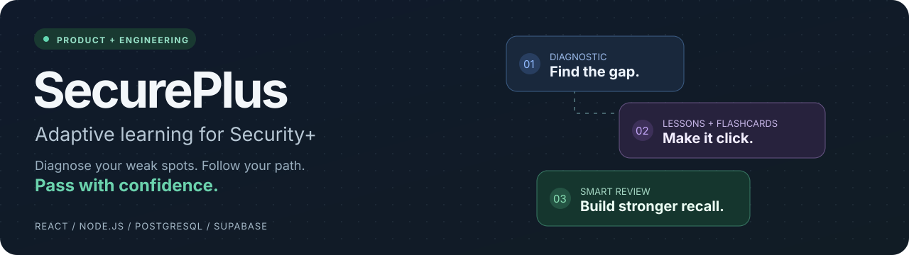
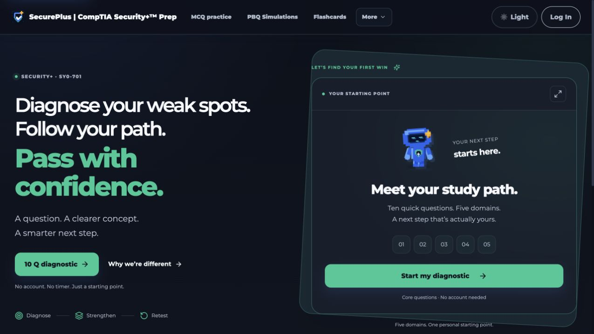
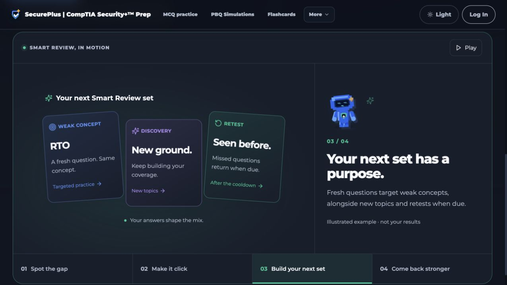

<p align="center">
  
</p>

<p align="center">
  <strong>A shipped learning product that turns missed questions into a practical next step.</strong>
</p>

<p align="center">
  <a href="https://www.secureplusprep.com/"><strong>Try the live product ↗</strong></a>
  &nbsp; · &nbsp;
  <a href="#a-90-second-product-tour">Product tour</a>
  &nbsp; · &nbsp;
  <a href="docs/engineering-overview.md">Engineering walkthrough</a>
  &nbsp; · &nbsp;
  <a href="docs/developer-setup.md">Run locally</a>
</p>

<p align="center">
  
  
  
  
</p>

## The problem

More practice questions do not automatically create a better study plan. A learner can finish a set, see a score, and still not know **what to study next**.

SecurePlus connects diagnostic MCQs, concept lessons, flashcards and Smart Review around the concepts a learner struggles with. It is designed for CompTIA Security+ SY0-701 preparation, with a low-friction guest diagnostic before account creation.

## A 90-second product tour

**1. Find a starting point.** Open the [live site](https://www.secureplusprep.com/) and try the ten-question diagnostic. It draws short Core questions from all five exam domains and marks answers as you go.



**2. See the learning loop.** Scroll to **“Smart Review, in motion”**. The interactive illustration connects a missed question to a Deep Dive, a flashcard and a later retest. Its example is labelled separately from learner results.



**3. Continue with a personal review plan.** A completed diagnostic can carry mastery, weak concepts and missed-question retests into an account. Registered practice mixes due retests, questions on weak concepts and broader discovery.

| Capability | What it demonstrates |
| --- | --- |
| **Smart Review** | Rule-based MCQ selection, per-concept mastery and delayed retests. |
| **Connected learning** | Missed concepts link to existing Deep Dives and matching flashcards. |
| **Exam rehearsal** | Timed MCQ sets, marking after submission and a visual report. |
| **Progress dashboard** | Readiness breakdowns, activity metrics and refreshed practice allowance. |
| **Content operations** | Question Manager, concept tagging and source-bound question revisions. |
| **Full-stack product flows** | Authentication, saved progress, practice quotas and Stripe access passes. |

## Engineering worth looking at

| Decision | Implementation to inspect |
| --- | --- |
| **Keep adaptation understandable.** Retest, remediation and discovery are explicit selection rules. | [`server/mcq-engine/engine.mjs`](server/mcq-engine/engine.mjs) |
| **Grade trusted snapshots.** In-progress sets retain their question revisions; the API validates owned sessions and selected option IDs. | [`http.mjs`](server/mcq-engine/http.mjs), [`catalogue.mjs`](server/mcq-engine/catalogue.mjs) |
| **Make retries safe.** Database transactions and stable answer IDs protect mastery and retest state from duplicate submissions. | [`MCQ engine migration`](supabase/migrations/20261019163949_mcq_three_deck_engine.sql), [`database tests`](scripts/test-mcq-engine-database.mjs) |
| **Preserve the guest-to-account journey.** Diagnostic import is snapshot-bound, transactional and replay-safe. | [`GuestDiagnostic.jsx`](src/components/GuestDiagnostic.jsx), [`diagnostic handoff migration`](supabase/migrations/20261024012841_guest_diagnostic_handoff.sql) |
| **Explain the product visually.** Animated illustrations pause offscreen and offer manual steps and reduced-motion support. | [`SmartReviewStory.jsx`](src/components/SmartReviewStory.jsx) |
| **Keep progress responsive.** Shared snapshots refresh in the background without replacing useful data with an empty loading screen. | [`useLiveSnapshot.js`](src/lib/useLiveSnapshot.js) |

For architecture, trade-offs and the AI-assisted development process, read the [engineering walkthrough](docs/engineering-overview.md).

## AI-assisted development, clearly scoped

AI coding assistants supported implementation, UI iteration, content-tagging drafts and test development. The project owner directed requirements, product decisions and the concept taxonomy.

**The current Smart Review runtime is deterministic, not an LLM service.** This repository does not claim a Meta-model integration or a submitted hackathon entry. It is evidence of a shipped product and an AI-assisted development workflow; any future model integration needs its own implementation and evaluation.

## Run locally

Use **Node.js 24** and npm. A basic frontend preview does not need service credentials:

```bash
git clone https://github.com/secureplussupport-dotcom/SecurePlus_Site.git
cd SecurePlus_Site
npm ci
npm run dev
```

Open the URL printed by Vite, usually `http://127.0.0.1:5173/`.

The landing page, public flashcards and local demo interface can be inspected this way. Server-backed diagnostics, account authentication, adaptive persistence and billing need configured services and the API runtime. Follow the [developer setup guide](docs/developer-setup.md) for those flows.

## Verification

```bash
npm run audit:mcq-engine           # Selection, grading, pacing, readiness and diagnostic checks
npm run audit:mcq-engine:database  # API + SQL integration using disposable PostgreSQL in WASM
npm run audit                     # Product, content, access, SEO and PWA checks
npm run build                     # Production bundle
```

The integration tests use **PGlite**, so the engine's database checks do not require a production database or live learner accounts. These checks are not a substitute for a complete security audit or end-to-end verification of external services.

## Repository map

```text
src/
  components/       Product screens, reports, animations and reusable UI
  lib/              Client state, pacing, concept links and service clients
  data/             Versioned question content, tags and flashcard seeds
server/
  mcq-engine/       Current adaptive MCQ selector and request handler
  stripe/           Checkout, access-pass fulfillment and legacy billing support
api/                Vercel serverless entry points
supabase/
  migrations/       Versioned database changes, private engine state and permissions
scripts/            Audits, build helpers and disposable database tests
docs/               Current feature guides, engineering notes and historical design records
```

Start with the [documentation index](docs/README.md). Historical `phase-*` records describe earlier work and should not be read as the current runtime specification.

## Current trade-offs

- `src/App.jsx` still contains a large amount of legacy UI. Newer engine, reporting and state logic is extracted into focused modules; further screen extraction is ongoing work.
- A fresh full-stack installation requires manual database and service configuration. The frontend preview is the quickest reproducible entry point.
- Practice content exists in the client bundle; this is a learning product, not a secure examination or anti-cheating system.

---

Independent learning platform. CompTIA and Security+ are trademarks of their respective owners; SecurePlus is not affiliated with CompTIA.
