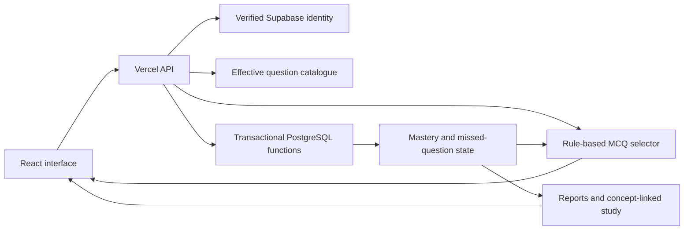

# Engineering walkthrough

SecurePlus is a shipped Security+ study product. This guide is a short route through the implementation for reviewers, collaborators and developer-program applications.

## The core product loop

A learner answers an MCQ. The server validates the selected option against its question snapshot, records the answer and updates the scored concept. Future Smart Review sets use that state to mix delayed retests, remediation and discovery. Related lessons and flashcards provide another way to study the same concept.

## Read the code in this order

1. **Selection:** [`engine.mjs`](../server/mcq-engine/engine.mjs). See how question allocation, cooldowns and Core recovery work without a model call.
2. **Boundary:** [`http.mjs`](../server/mcq-engine/http.mjs). Follow bearer-token validation, request checks, owned sessions and grading.
3. **Question revisions:** [`catalogue.mjs`](../server/mcq-engine/catalogue.mjs). Effective Question Manager content is merged with the source catalogue; answer-option IDs are source-bound.
4. **Persistence:** [`MCQ engine SQL`](../supabase/migrations/20261019163949_mcq_three_deck_engine.sql). Inspect private state, transactions, owner locking and retry behavior.
5. **Evidence:** [`database tests`](../scripts/test-mcq-engine-database.mjs). The test suite runs real SQL functions in disposable PostgreSQL through PGlite.
6. **User experience:** [`GuestDiagnostic.jsx`](../src/components/GuestDiagnostic.jsx), [`McqSetResults.jsx`](../src/components/McqSetResults.jsx) and [`SmartReviewStory.jsx`](../src/components/SmartReviewStory.jsx). See how the learning state becomes a usable product.

## Decisions and trade-offs

| Choice | Why it is useful | Cost or limitation |
| --- | --- | --- |
| Deterministic adaptation | Behavior can be explained and tested against exact inputs. | It does not provide open-ended tutoring or semantic reasoning. |
| Server-side grading with session snapshots | A later content edit cannot silently change an in-progress answer key. | Snapshot and live-catalogue paths need separate validation. |
| Atomic answer recording | Retries and concurrent requests cannot independently update only part of the mastery state. | PostgreSQL functions become part of the application logic and need integration tests. |
| Static content plus manager overrides | Versioned seeds remain inspectable while published content can evolve. | Override precedence and source revisions must stay explicit. |
| Reusable React/CSS illustrations | The product can explain its behavior without a video dependency or large media download. | Reduced motion, pause controls and responsive layouts need deliberate handling. |
| Incremental extraction from a large app file | New behavior can be separated without a risky whole-application rewrite. | `App.jsx` remains an obvious refactoring opportunity. |

## AI-assisted development

The development workflow used Codex for implementation, UI iteration and test development, and Gemini-assisted drafts for some concept tagging. The project owner supplied requirements, directed the product and made content/taxonomy decisions.

The useful engineering evidence is the shipped behavior and its checks: source-bound grading, replay-safe imports, database rollback tests, explicit access boundaries, responsive UI and deployment verification. AI-generated output is not treated as proof that a feature works.

The current application has no Meta-model or other generative-model inference service in its Smart Review runtime. Adaptive scheduling is implemented in JavaScript and PostgreSQL. Any future model-backed feature should document its provider, inputs, evaluation cases and failure behavior separately.

## For a developer-challenge application

Use this repository and the live demo as **prior shipped-project evidence**. A concise application description can explain the learning problem, the product loop, the AI-assisted build process and the concrete engineering examples above. Do not describe it as a Meta-powered application or claim competition acceptance, results, user growth or learning-outcome improvements without evidence.

The [official Meta Global AI Developer Hackathon page](https://dev.meta.ai/events/global-hackathon) is the source for the program's current application criteria and rules. This repository is not a declaration that the existing product is an eligible competition submission.

## Verification boundaries

Local engine/database tests are reproducible without live learner accounts. Connected signup, billing and deployed access behavior require separate environment-specific checks. The repository does not currently provide an enabled GitHub Actions pipeline; commands in `package.json` are the verification entry points.
