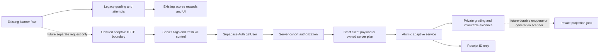
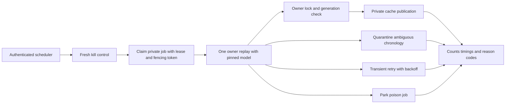

# Phase 2B-3 — production architecture and migration readiness

Date: 2 October 2026. Baseline: `f18ae7a97cef5f6d22aeec5093f2545a506a7779`.

## Executive status: NOT READY

Selected architecture: **Vercel Node functions for authenticated requests and bounded workers, connecting to Supabase PostgreSQL through the transaction pooler.** Keep Supabase Auth as the identity authority and the existing attempts path as the learner-facing authority.

This package implements and locally tests an unwired HTTP boundary and a worker adapter. It does not deploy an endpoint, provision a production pool/login, install a durable queue, connect learner submissions, change production configuration, or activate any real adaptive version. Production remains hard-denied even if an enable flag is supplied. All new operational outputs are receipts or aggregate diagnostics, not learner scores or mastery.

Live catalog inspection succeeded. The foundation has no adaptive namespace/object conflict, but that is not enough for approval. Remaining gates include deletion integration, restricted production database credentials and pool validation, private shadow visibility, durable jobs, the complete pinned projection adapter, live API exposure, and a verified recovery point. **Do not apply the migration or start a cohort on the strength of this report.**

Evidence authority: the master plan remains the product specification; Phase 1 remains the original current-state audit; Phase 2A supplies provisional model rules; Phase 2B-1 supplies the proposed persistence design; the updated Phase 2B-2 report and actual `f18ae7a` implementation establish the newer local foundation. Earlier documents were checked against the repository; their files are unchanged from the versions read in the preceding work. The Phase 2B-2 report was read in full. No human approval or educational validity is inferred from synthetic tests.

## Current production architecture

| Area | Source-backed current behavior |
| --- | --- |
| Frontend | React/Vite; primary flows and in-browser grading are in `src/App.jsx`. Questions include legacy answer truth in the existing application bundle. This phase adds no new browser grading data. |
| Browser Auth | `src/lib/supabaseClient.js` uses `VITE_SUPABASE_URL` and `VITE_SUPABASE_ANON_KEY`; `getSession()` retrieves the browser access token. App initialization also subscribes to Auth changes. Browser session state is not server verification. |
| Trusted server | `api/*.js` dispatches to `server/*`; `vercel.json` rewrites stable routes such as `/api/attempts/submit` and `/api/account/delete`. Existing handlers call `supabase.auth.getUser(token)`. |
| Credentials | `api/_utils.js` creates a non-persistent Supabase service-role client from server environment variables. Stripe and email secrets are server-side. New Auth verification requires only a publishable/anon key, not service authority. |
| Attempts | Individual question attempts are written from the authenticated browser to `attempts`; `server/attempts/submit.js` accepts a client session score and writes a summary plus legacy reward/achievement effects. This is not trusted per-question grading. No change was made to it. |
| Deletion | Email/token confirmation → claim deletion request → cancel Stripe subscription → global Auth sign-out → `auth.admin.deleteUser`. There is **no** call to `adaptive_private.delete_learner_data`. |
| Analytics | `src/lib/analytics.js` uses client PostHog capture and identified profiles. Existing server routes use console logging. There is no dedicated adaptive operations sink, alerting dashboard or queue monitor deployed. New adaptive telemetry deliberately does not use identified PostHog events. |
| Deployment | Vercel configuration has an ignored-build script recognizing `[skip deploy]`. This delivery uses that marker and changes no route or deployment setting. No Vercel deployment command is run. Dashboard configuration and actual production environment values were not inspected. |
| Database | Authenticated read-only metadata inspection confirmed 16 public tables, 35 policies, 47 indexes, 74 constraints, seven event triggers and an empty migration inventory. No adaptive objects are installed. |

Previously observed integration drift is still material: live `attempts` lacks `session_type`, `duration_seconds`, and `questions_count`, although the legacy summary handler writes them. Achievement tables/functions expected by that handler are absent. Those existing issues are not repaired here and must not be concealed by adaptive rollout results.

## Architecture decision and alternatives

| Criterion | Vercel Node functions — selected | Supabase Edge Functions | Existing legacy handler / new persistent server |
| --- | --- | --- | --- |
| Security | Existing server boundary; isolated adaptive module/route and credential scope | Separate secret boundary; still requires verified Auth and explicit ownership | Reusing attempts/coins handler couples sensitive effects; a new server adds another credential boundary |
| Transactions | Reuse `postgres@3.4.9` and `sql.begin()` through transaction pooling | PostgreSQL transactions are possible, but require separate runtime/packaging verification | Persistent Node supports the same driver, but none is currently operated |
| Pooling | One client per warm function instance, initially `max:1`, `prepare:false`; transaction pooler | Also requires bounded connections and transaction-compatible code | Persistent pool easier to budget, but requires service capacity and lifecycle management |
| Latency | Auth network round trip plus pool/SQL; choose region near DB and measure cold/warm paths | Geographic edge placement does not remove distance to the database | Existing handler has no added hop but creates coupling; new server requires measured placement |
| Retry semantics | Database idempotency; worker queue owns retry/backoff | Same database requirements | Same requirements; a long-lived process does not make retries safe automatically |
| Projection execution | Bounded scheduled drain; durable queue and lease required | Current documented CPU cap is a poor fit for growing replay histories | Dedicated worker becomes a later option if measured replay exceeds function budgets |
| Operations / parity | Current Node/ESM repository and local tests transfer directly | Additional Deno/Edge deployment, packaging and operational path | Existing route cheapest to wire but unacceptable failure coupling; new server needs an operator |
| Cost / scaling | Function invocations/compute plus Auth/DB load; connections, not just requests, must be bounded | Function invocations plus Auth/DB; limits differ | Persistent baseline compute cost and maintenance before demand is measured |
| Lock-in | Thin HTTP/scheduler adapter; PostgreSQL and core Node services portable | Edge deployment/runtime conventions add migration work | A generic Node worker is portable but adds immediate operations burden |

This choice follows repository fit rather than novelty. No pricing or production capacity estimate is asserted without the account plan, region, concurrency and observed workload. Cost model for review: request count × Auth+transaction time, plus replay count × history cost, plus pool occupancy. No new paid service was purchased.

Current official references: [Vercel Node functions](https://vercel.com/docs/functions/runtimes/node-js), [Supabase connection modes and serverless pool sizing](https://supabase.com/docs/guides/database/connecting-to-postgres), [Supabase Edge limits](https://supabase.com/docs/guides/functions/limits), and [Vercel cron behavior](https://vercel.com/docs/cron-jobs/manage-cron-jobs). Cron invocations can overlap and are not automatically retried; cron alone is not a durable job queue.

### Planned production connection contract — not provisioned

Copy the actual transaction-pooler hostname from Supabase's Connect panel; do not construct it from a region. Use port 6543, prepared statements disabled, module-scoped pool size one initially, encrypted transport with certificate verification and the appropriate CA, and bounded acquisition/statement/lock timeouts. No session-scoped state, session advisory lock, temporary-table or prepared-statement assumptions may cross transactions. The implemented advisory locks are transaction-scoped.

Proposed budgets to validate: acquire/connect ≤3 seconds, lock wait ≤1 second, request transaction ≤5 seconds, worker transaction ≤10 seconds. Apply transaction-local timeout settings through a reviewed production adapter. Existing `database.mjs` remains loopback-only and is not that production adapter.

Vercel's [Fluid Compute pool guidance](https://vercel.com/kb/guide/efficiently-manage-database-connection-pools-with-fluid-compute) also requires managing idle connections around instance suspension. Verify compatibility of the pinned Postgres.js driver with the supported lifecycle mechanism; do not assume a `pg` helper example works unchanged. No driver swap or Vercel package was installed here.

Do not deploy a `postgres` superuser connection or use the broad existing service-role secret as the production DB password. Provision a separately reviewed server login with only the adaptive object privileges it needs; review any inherited PUBLIC function privileges and RLS bypass deliberately. The local test's `SET ROLE service_role` proves the present service grants, not a future restricted login. Pooler TLS, grants, revocation, connection ceilings and Vercel suspension behavior need an environment-specific rehearsal before approval.

## Request and worker data flows





Solid edges describe the selected architecture, not a deployed system. The HTTP module is exercised locally. Queue storage, scheduler authentication/deployment and the complete model adapter remain designed or blocked as detailed below. Neither diagram has an adaptive path into learner selection, recommendations, scores, rewards, achievements, access or UI.

## Authentication and trust boundaries implemented locally

`auth.mjs` verifies the bearer through Supabase Auth `getUser`, rejects anonymous users, and returns only the verified ID. It uses a bounded network request and never authorizes from email, `user_metadata`, an unverified JWT decode, or browser `getSession`. This follows the [official getUser contract](https://supabase.com/docs/reference/javascript/auth-getuser).

`http-boundary.mjs` exports a Fetch-style Vercel-compatible handler, **without adding an `api/` route**. Its default configuration, cohort authorization and kill control all deny execution. Production and Vercel environments remain hard-denied. Tests supply explicit disposable-local configuration; no environment file or production flag changed.

The request body is bounded to 32 KiB. Only POST JSON and four operations are accepted:

| Operation | Client authority | Server authority |
| --- | --- | --- |
| `session` | Opaque `planId` only | Owner-scoped immutable plan containing exact manifest, stable session ID, versions and composition |
| `answer` | Client event ID, owned session/item/revision, stable selections, occurrence and optional duration | Exact protected grading, ownership, mappings, exposure, receipt metadata and transaction |
| `intervention` | Recommendation ID, activity/lifecycle claim, time and event ID | Owned recommendation/content and injected verified completion criteria; default is unverified |
| `session_event` | Event ID, owned session, completed/abandoned claim and time | Ownership/time bounds, immutable event and generation invalidation |

Recommendations, review tasks, trusted corrections, version IDs, concepts and exposure classifications cannot be submitted through this learner boundary. A future internal pinned planner calls the existing recommendation/task persistence services. No production planner, owned plan store or trusted activity-verification source is fabricated in this phase.

Successful responses are exactly `{status:'accepted', receiptId}`. Identical retries return the same response. Conflicting identities return 409. Other failures expose a generic status and random incident ID; they never return correctness, protected explanations, keys, internal concepts or mastery. `preserveLegacyResult` is a tested unwired failure-isolation helper; future integration must make the adaptive request separately after the legacy result is committed, with its own bounded delivery policy. It must not delay or gate the legacy response.

The request gate rereads control before database work and after pool acquisition. A future centralized control source must fail closed and have no stale cache beyond the approved shutdown budget. Environment changes alone are not an instant global kill switch. Already-running transactions may finish; credential revocation/connection cancellation is an incident escalation, not routine disablement.

### Transaction changes validated here

- Session creation now serializes per owner, compares a repeated immutable plan, returns the existing session on identical retry, rejects conflicts, and appends the start event in the manifest transaction.
- Answer ingestion acquires the same owner advisory lock before exposure classification, so simultaneous submissions cannot both classify themselves from the same outdated history snapshot.
- The worker and intervention writer use the same owner lock order. Redundant `FOR KEY SHARE` reads on immutable records were removed from answer/intervention lookup: they required UPDATE privileges absent from the intended service grants. Owner deletion and these writes share the advisory lock; shared catalog records remain immutable.
- Session completion/abandonment has an idempotent service and marks projections stale while advancing owner generation. Closing a session can therefore trigger a new chronology assessment instead of leaving an old quarantine indefinitely authoritative.

No schema or migration file changed. Existing task/recommendation writers and the complete deletion lifecycle still require the broader concurrency review before production, including rejecting writes after deletion has started.

## Projection execution design and implemented adapter

`job-boundary.mjs` is a bounded drain adapter: at most five claims per invocation, one job at a time, checks the kill control before each claim and execution, invokes `rebuildAdaptiveOwner`, parks quarantine/poison jobs, and retries explicitly transient errors with bounded exponential backoff. It returns only counts. It does not authenticate a public worker endpoint because no such endpoint exists.

Required durable store contract, **not implemented**:

1. Private queue, unique `(owner_id, generation, mapping_version, algorithm_version, configuration_version)` identity; owner FK/deletion cleanup and bounded payload with no answers.
2. Atomic `FOR UPDATE SKIP LOCKED` claim, 30-second lease and monotonically increasing fencing token. All acknowledgments/retries/releases verify the token; expired workers cannot acknowledge newer leases.
3. Initial global worker concurrency two, per-owner one; the database enforces the limit across function instances. The local adapter's serial loop alone is insufficient.
4. Attempts start at one. Retry serialization/deadlock/connection/capacity failures after 2, 4, 8 and 16 seconds, capped at five attempts; production store should add bounded jitter. Park permanent failures without blocking other owners. Quarantine requires investigation, not blind retry.
5. Enqueue in the ingestion transaction or use a durable generation scanner with a last-enqueued watermark, so a process crash after evidence commit does not lose replay work. Queue deduplication is independent of HTTP idempotency.
6. Keep generation pending if newer evidence appears. Completion may acknowledge only the claimed generation; scanner enqueues the newer one. Resume abandoned leases safely after function death.
7. Scheduler authentication must use a separate rotated server credential/OIDC mechanism. Learner tokens cannot choose replay owners. Rate-limit and authenticate before queue access.

The current worker holds an owner row lock while calling the injected projector. Its snapshot includes sessions and evidence, but not a complete verified intervention/task/version-payload bundle. The local fixture is a small injected projection, not the final Phase 2A adapter. Before production, supply the complete pinned snapshot and model registry, resolve corrections and full-history novelty, validate all resulting cache rows, measure replay duration, and bound lock occupancy. Do not inject arbitrary caller-selected code or trust a client model/version.

No job may grant coins, access, achievements, rewards or learner-facing mastery. At larger histories, move expensive computation outside the write transaction using an immutable input snapshot and a generation compare-and-swap commit; require separate measured validation before replacing the current locking strategy.

## Read-only live-schema reconciliation

Executed against the connected SecurePlus project using catalog SELECTs and read-only migration listing. No production learner rows, answer payloads, or secrets were retrieved.

| Item | Evidence / conclusion |
| --- | --- |
| Names | No `adaptive_private` schema, public `adaptive_%` relations or adaptive functions; no discovered naming collision |
| Version parity | Live PostgreSQL **17.6**; local **17.11**. Same major, different minor. Production-version staging rehearsal remains a gate |
| Migration order | Live migration list empty. Apply only the one reviewed additive file after approval; never replay old setup SQL or use a blanket push to infer a baseline |
| Existing objects | 16 public tables / 35 policies / 47 indexes / 74 constraints; seven DDL/event hooks. `ensure_rls` and PostgREST refresh hooks can run during DDL |
| Auth FKs | Existing application owned rows mainly cascade on Auth deletion; new adaptive owner FKs restrict deletion. The dedicated deletion helper must be integrated before any adaptive learner data is allowed |
| Extensions | `pg_stat_statements` 1.11, `pgcrypto` 1.3, `plpgsql` 1.0, `supabase_vault` 0.3.1, `uuid-ossp` 1.1. No new extension install is requested by this migration |
| Grants/RLS | Foundation explicitly revokes/grants and enables RLS. Local actual API/role checks pass. Existing default grants are broad; final private-table grants must be rechecked after live application |
| Private function owner | Deletion guard expects definer `current_user='postgres'`. The applied function owner must be verified; an arbitrary migration role is not interchangeable |
| API schemas | Catalog `pgrst.db_schemas` settings returned null. Dashboard-exposed schema configuration and live private REST/GraphQL denial remain **unverified**, not passed |
| Connections | Production pooler hostname, restricted login, TLS/CA, limits, network access and Vercel region/plan unverified |
| Recovery | Backup/PITR availability and a usable restoration point unverified; no backup or restore was initiated |
| Final drift comparison | PASS: full before/after baseline objects are identical, including columns, functions, triggers, policies, grants and constraints; migration inventory remains empty |

Read-only query assets: existing `adaptive-live-baseline.sql` plus new `adaptive-production-preflight.sql`. The latter can run before or after migration; zero adaptive rows before installation is expected and does not prove post-installation security. Official [PostgreSQL minor-release notice](https://supabase.com/changelog/postgres-15-19-17-11-breaking-changes) and [Data API grant changes](https://supabase.com/changelog/45329-breaking-change-tables-not-exposed-to-data-and-graphql-api-automatically) were reviewed. Explicit grants/RLS must be verified rather than assuming auto-exposure defaults.

### Shadow visibility blocker

The existing foundation requires active approved versions to start sessions. Its authenticated owner-read policies then permit reads of adaptive rows, including projections. Although the new HTTP response strips internal results and no UI reads them, **that alone is not private shadow isolation**. Before a cohort, review a separate shadow authorization/publication state and deny learner reads of shadow projections/recommendations/tasks. Keep current real pilot versions pending/inactive. Do not bypass approval triggers or activate versions simply to make the writer run.

## Migration and recovery runbook — designed, not executed live

### Preconditions and abort gates

- Obtain explicit approval for a precisely identified commit and migration checksum after the blockers below are resolved. Confirm target project, region, PostgreSQL version and migration identity independently.
- Verify a recent recovery point and rehearse restoration to an isolated project. Proposed maximum data-loss window: five minutes, or a separately accepted maintenance window with writes paused. Confirm restore permissions and accountable operator. Database backups do not cover stored object bytes or custom-role passwords; plan those separately under [Supabase backup guidance](https://supabase.com/docs/guides/platform/backups).
- Capture the full catalog baseline and read-only preflight. Abort on an existing adaptive namespace, unexpected schema drift, missing standard roles/Auth schema, wrong function owner assumptions, or an incomplete migration inventory.
- Keep all adaptive routes absent/disabled, worker scheduler absent, cohort empty, versions inactive, and flags off. Keep the existing application serving normally.
- Require passing isolated PostgreSQL 17.6-compatible rehearsal, real role/API security checks, the deletion integration rehearsal, the restricted production-role/pool rehearsal and the agreed recovery evidence. The current tests alone do not meet these gates.

### Exact order after separate approval

1. Open a reviewed migration connection as the intended owner; confirm `current_database()`, `current_user`, `server_version` and target identity without printing connection strings.
2. Set conservative session lock/statement timeouts (proposed 3 seconds / 60 seconds) for the migration connection. Apply **only** `supabase/migrations/20261001170334_adaptive_learning_persistence_foundation.sql` through the agreed migration-history mechanism. It already contains `BEGIN` / `COMMIT`; do not split its statements into independent PostgREST calls. Do not run other `supabase/*.sql` setup files.
3. The migration creates empty additive objects; it seeds and activates nothing. Expect exclusive locks on new relations and brief referenced-table locks on `auth.users` while establishing foreign keys. DDL event hooks also execute. It does not rewrite existing learner tables; still measure auth contention in rehearsal. A lock timeout is an abort, not permission to raise limits automatically.
4. Run both read-only validation assets. Require 24 adaptive tables with RLS, zero private client table grants, no anonymous private function execution, and only the intentional authenticated `version_active(text)` helper. Verify that the deletion helper is owned by postgres, SECURITY DEFINER with an empty search path, and unavailable to anon/authenticated callers.
5. Verify migration history contains exactly the intended new migration once. Recompare pre-existing tables/columns/functions/policies to the baseline and investigate every difference. Run advisors; no new warning/error may be accepted without review.
6. Using separately authorized synthetic accounts, verify anonymous and cross-user denial, denied browser writes, protected grading invisibility, and inactive-version rejection through the actual REST API. Do not run `adaptive-local-checks.sql` against live: it activates fictional versions and assumes a disposable fixture. Positive owned adaptive-write checks require an explicitly approved shadow catalog and come later.
7. Exercise confirmed deletion with a synthetic graph in the approved rehearsal environment, including concurrent in-flight writes and worker leases. Ensure adaptive cleanup and broad Auth deletion compose correctly, another owner survives, catalog/actor provenance survives, and no identifiable queued job remains. Empty-schema deletion alone is not sufficient.
8. Leave schema dormant. Do not publish/activate versions, set production flags, create a cohort or deploy the adaptive route as part of the migration approval.

Read-only post-install checks include:

```sql
select n.nspname, c.relname, c.relrowsecurity
from pg_class c join pg_namespace n on n.oid=c.relnamespace
where c.relkind='r'
  and (n.nspname='adaptive_private' or (n.nspname='public' and c.relname like 'adaptive_%'));

select grantee, table_name, privilege_type
from information_schema.role_table_grants
where table_schema='adaptive_private' and grantee in ('PUBLIC','anon','authenticated');

select count(*) as active_events from public.adaptive_version_events where action='activate';
select count(*) as learner_sessions from public.adaptive_sessions;
```

Expected immediately after an empty migration: 24 RLS-enabled tables; no private client grants; zero activation events; zero learner sessions. A failed SQL statement or unexpected result stops the run. Grant leakage, changed legacy objects, unexpected learner records, activation or deletion failure are immediate incidents.

### Disable, roll forward and rollback limitations

Disable the central control first and set the deployment enable flag false/kill flag true; stop scheduling new claims. Confirm accepted-write and claim counts stop within the approved window, allowing bounded in-flight completion. Keep legacy attempts and UI serving. Do not delete evidence to conceal errors.

An initial migration transaction failure should roll back its own DDL; verify state and migration history before retrying. After a successful additive migration, prefer leaving empty/dormant objects in place. A partially recorded migration must be reconciled manually by the approved operator, not blindly rerun. Repair later with a reviewed additive migration and replays under new immutable versions. Do not drop populated schemas or rewrite history. Whole-project recovery can lose unrelated writes and cause downtime; reserve it for an explicitly authorized disaster recovery decision.

## First shadow cohort — proposal only, not created

| Dimension | Proposed initial rule |
| --- | --- |
| Eligibility | Five consenting internal test accounts first; then at most 20 explicitly opted-in authenticated adults after clean review. Server-owned allowlist, never browser metadata |
| Exclusions | Guests, anonymous Auth, accounts deleting/under erasure, unsupported PBQs/revisions, incomplete manifests, unapproved mappings, incomplete history, and legacy backfill |
| Duration | Seven days at the 20-account cap; no automatic expansion |
| Retention | Raw shadow learner evidence/jobs at most 30 days, shorter on account deletion; privacy-safe aggregate operational logs 14 days. Implement scoped expiry erasure and backup-retention disclosure before launch; normal immutable tables do not provide this automatically |
| Behavior | Zero influence on question selection, grading, recommendations shown, rewards, coins, access, achievements or UI |
| Metrics | Accepted/rejected submissions, identical/conflicting retries, missing-delivery reconciliation, transaction latency/error rate, queue age/retries/parks, generation conflicts, quarantine reasons and deterministic replay disagreement |
| Error budget | Adaptive unexpected failure ≤0.5% per rolling 24 hours; early cohort also stops for three unexpected failures in 15 minutes. Ownership/credential leaks and legacy-impact tolerance are zero |
| Latency | Request p95 ≤500 ms warm, p99 ≤1500 ms; cold-start p95 ≤2 s measured separately. Legacy latency increase must be unmeasurable within test noise because no adaptive work is on its response path |
| Worker | Job age p95 ≤60 seconds and oldest ≤5 minutes; transaction p95 ≤2 seconds and max ≤10 seconds; two global workers initially |
| Quarantine | Investigate every case; stop expansion above 5% of eligible owners or any unexplained single-session quarantine; stop cohort above 10% after at least ten owners |
| Disagreement | Same inputs/versions must replay identically: any state/digest nondeterminism stops workers. Compare shadow grading with immutable-revision truth; legacy mismatch is investigated and never fed back into legacy scoring |
| Deletion | Synthetic full-graph deletion before enablement, daily during cohort, and after disablement. Zero owner rows/jobs after completion; preserve shared editorial provenance |
| Kill-switch owner | Founder accountable; named technical operator and backup must be assigned before launch. No person is assumed to have accepted this duty |
| Daily review | Operator checks aggregate dashboard, investigates incident codes through access-controlled private diagnostics, reviews delivery/latency/quarantine/deletion, and records go/hold/stop |
| Promotion | Seven clean days, no critical incidents, deterministic replay, deletion proof, budget compliance, reviewed mappings and enough scenario coverage; explicit new approval required. Promotion here means a larger shadow experiment, not learner-visible mastery |

Immediate shutdown: cross-owner access, grading/credential exposure, unexpected version activation, any adaptive influence on legacy outcomes, deletion failure, sustained database pressure, unsafe logging, or no working kill-control source. Proposed thresholds and retention require founder acceptance; they are not already approved policy.

## Observability

`operations.mjs` emits allowlisted events with only `event`, `reason`, random `incidentId`, `count`, and bounded `durationMs`. It drops caller metadata and arbitrary reason strings; logger failure cannot escape. No answers, selections, learner/session/evidence IDs, emails, tokens, connection strings or raw exception messages are accepted.

| Event | Interpretation |
| --- | --- |
| `runtime_accepted`, `runtime_rejected` | Receipt accepted or denied; reason is from a fixed enum |
| `idempotent_retry` | Existing immutable result returned |
| `transaction_failure` | Generic failure count/timing; private details not logged |
| `projection_success`, `projection_failure` | Cache rebuild outcome; no mastery values |
| `quarantine` | Chronology conflict category; detailed enum reasons remain in protected owner state |
| `generation_conflict` | Retryable generation/serialization conflict |
| `kill_switch` | Gate denied new work; aggregate counts confirm shutdown |
| `deletion_complete`, `deletion_failure` | Supported event types for future integrated deletion; not wired to the current production deletion route |

Production sink, retention enforcement, dashboards, alarms and centralized control are not deployed. Keep these events separate from identified PostHog learner analytics. Drain/store errors also need scheduler-level safe monitoring; the store adapter is not a complete operations service.

## Validation evidence

| Executed check | Result |
| --- | --- |
| Local Colima / Supabase startup | PASS, existing installed runtime reused; disposable workspace `/tmp/secureplus-phase2b2-resume.5kVVpr` |
| Local reset/migration and rollback SQL validation | PASS, PostgreSQL 17.11; no live substitute |
| `audit:learning-boundary` | PASS, 15 tests: Auth, forged fields, body limits, kill gates, safe logging, legacy failure isolation, worker backoff/poison/quarantine, deletion blocker and imports |
| `audit:learning-boundary:database` | PASS, 18 checks using real local Auth and PostgreSQL as `service_role`; session/answer retries and conflicts, ownership, safe receipts, lifecycle invalidation, kill switch and cleanup |
| `audit:learning-database` | PASS, 28 existing executable transaction, real REST/RLS, concurrency, projection, index and deletion assertions |
| `audit:learning-runtime` | PASS, 40 scenarios |
| `audit:learning-persistence` | PASS, 20 contract scenarios |
| `audit:learning-migration` | PASS, 189 static checks / 24 tables |
| `audit:learning-pilot` | PASS |
| Local lint / advisors | PASS at configured error/warning thresholds; final advisor result contains no issues |
| Build and all eight site audits | PASS; existing large-bundle warning. Includes editorial and strict question-bank checks |
| Browser source/import boundary | PASS; no new adaptive import in `src/` or routed `api/` files |
| Final bundle scan / diff / live metadata comparison | PASS: no adaptive server imports/credential markers in the built assets; clean diff check; full live catalog baseline unchanged |

The existing disposable audit uses explicitly fictional `local-*` catalog approvals/activations solely to exercise guards; it does not approve or activate any real pilot/production version. No live test account, migration, seed, backfill, deployment or configuration change was made. Local queue tests use a test store; durable lease/deduplication, production cold-start/load tests, global concurrency, recovery-point verification and end-to-end production deletion remain unexecuted.

## Files changed

- `server/adaptive/auth.mjs`, `http-boundary.mjs`: verified Auth and unwired request boundary.
- `server/adaptive/operations.mjs`, `job-boundary.mjs`: safe events, gates, legacy failure isolation and bounded worker adapter.
- `server/adaptive/persistence.mjs`, `projection-worker.mjs`: owner lock order, session retry/start/lifecycle behavior, remove unnecessary locking reads requiring excess privilege.
- `scripts/audit-learning-boundary.mjs`, `audit-learning-boundary-database.mjs`: meaningful boundary and actual Auth/database tests.
- `supabase/validation/adaptive-production-preflight.sql`: read-only catalog reconciliation.
- `package.json`: opt-in audit commands; no dependency change.
- `docs/phase-2b3-production-readiness.md`: this decision, evidence and runbook.

Unrelated `.gitignore`, Android/Capacitor, audit artifacts, output, review exports and temporary Supabase files remain unstaged. No `src/`, existing routed API, deployment configuration, content version, or migration file was changed.

## Remaining blockers and exact approvals

1. Integrate erasure with confirmed account deletion, worker cancellation and in-flight write rejection; verify access/session revocation and race behavior. Auth sign-out alone does not immediately invalidate every issued access token. Do not simply insert cleanup before `deleteUser` without a retryable deletion state machine.
2. Implement and prove the restricted production database adapter, pooler/TLS/timeouts, private queue and scheduler authentication/global limits.
3. Supply trusted immutable server plans, publication assets and the complete version-pinned projection/intervention/task adapter. Preserve the real RTO variant shortage and provisional thresholds.
4. Resolve private shadow visibility and version authorization without self-approving or activating pending pilot versions; enforce retention erasure.
5. Verify actual live API exposure, production runtime settings, account plan/region/connection budgets, PostgreSQL minor-version compatibility and recovery readiness.
6. Deploy privacy-safe monitoring and fresh kill-control infrastructure only after separate authorization; prove the shutdown and restoration drills.

Required future approvals, in order: completed migration/security/deletion review with checksum and recovery point; explicit live additive migration permission; separately reviewed runtime deployment and credentials; human editorial approval for real versions; separately approved shadow authorization/visibility state and cohort/retention/thresholds; explicit shadow enablement. Learner-facing personalization, UI, scoring, access and reward use are separate later approvals. This phase requests or executes none of those live changes.
