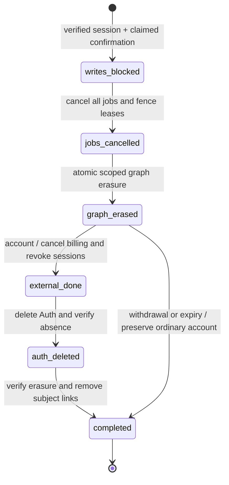
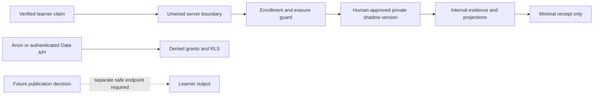

# Phase 2B-4A — secure deletion and private shadow isolation

Date: **3 October 2026, Asia/Singapore**. Starting commit: `b867386684ba5944dac6e5bc770ca6eabc3f61fc`.

## Executive verdict: READY FOR PHASE 2B-4B

The two Phase 2B-3 blockers are resolved **for the locally executed, unwired package**: a confirmed account deletion can durably block adaptive writes, erase the owned graph, cancel/fence test jobs, resume external-cleanup failures, and verify Auth removal; adaptive tables are unavailable to learners even when a version has activation history.

This is **not approval for a live migration or shadow cohort**. Phase 2B-4B must supply the restricted production connection and a durable queue implementing the tested cancellation contract. Production deployment, the real account-route integration, production monitoring/expiry scheduling, recovery rehearsal and the complete pinned learning adapter remain later gates. The existing Phase 2B-3 live-migration verdict remains **NOT READY**.

The master plan governs product decisions. Phase 1 and subsequent reports supply their dated implementation evidence. The earlier owner-read policies and active-version session requirement are superseded by the explicit Phase 2B-4A privacy requirement; this does not authorize publication or learner influence. Human editorial requirements and the provisional RTO coverage limitations are preserved. No unresolved product decision was used to change visible behavior.

## Existing account-deletion journey

Source: `src/App.jsx`, `server/account/delete-request.js`, `server/account/delete.js`, `supabase/account-deletion.sql` and the existing foundation migration.

1. Account settings requests a confirmation email with a bearer token. The server verifies it through Supabase Auth, enforces a 60-second resend cooldown, creates a random token, stores its SHA-256 digest, and gives it a 15-minute expiry. Resend or Supabase OTP sends the link.
2. The frontend captures the URL confirmation token, removes it from the URL, keeps the confirmation intent in session storage, and requires the signed-in user to confirm. It sends only `deletionToken` to the deletion route.
3. The route verifies Auth, atomically claims the matching unexpired request for that Auth user by setting `used_at`, then reads the user's Stripe subscription from the server-owned profile.
4. It cancels the subscription, tolerates Stripe `resource_missing`, signs out globally, then calls `auth.admin.deleteUser`. Application tables with Auth cascade FKs are removed; nullable actor references can be detached. Adaptive restrictive FKs prevent treating Auth deletion as adaptive erasure.
5. On failure, the existing route attempts to clear `used_at`, logs the raw error, and returns a generic failure that can say data was not removed. There is no durable checkpoint across external side effects. A failure after Stripe cancellation or sign-out therefore cannot be treated as a clean rollback.

**Integration point:** claim confirmation and persist the adaptive write block in one transaction, before billing/Auth side effects. Then cancel jobs, erase the adaptive graph, cancel billing, revoke sessions, delete Auth, and verify completion. Never reset the adaptive block on failure.

The live route, email route and frontend are **unchanged** and import no new module. They cannot call nonexistent adaptive objects. The new local handler checks the migration capability and refuses an absent schema; a future dispatcher must deliberately select the reviewed adaptive integration only when installed. Actual schema absence was tested by a transactionally rolled-back schema rename. This phase does not silently fall back to Auth deletion after an adaptive error.

The existing route's raw error logging and partial-failure copy must be replaced when that later integration is approved. The new implementation never copies those patterns.

## Implemented deletion state machine

Any failed step sets `failed_retryable=true` while retaining the last durable stage. It does **not** return to normal processing. A bounded internal resumer scans incomplete operations even after enrollment removal or Auth deletion. External operations repeat safely if the process dies before recording their checkpoint.

`erasure_operations` stores an opaque operation ID, the owner while work is incomplete, confirmation request reference where applicable, reason, stage, retry flag and timestamps. It stores no email, token, selected answer, exception string or billing payload. Completion clears both owner and confirmation links. The remaining unlinked receipt supports counts/retry acknowledgment. Incomplete subject links are necessary for recovery and need operational alerting; they must not be silently abandoned.

`confirm_account_erasure` verifies that the remotely verified token's `session_id` still belongs to its owner in `auth.sessions`, checks the owned confirmation digest and expiry, claims it, and creates the block in one transaction. The HTTP handler rejects an owner or operation ID in the body. A used confirmation can resume only its already-created operation. Internal recovery uses the operation ID after sign-out; no bearer token is stored.

The account cleanup adapter reads the Stripe subscription from `profiles`, requires a working cancellation client if a subscription exists, treats already-missing subscriptions as idempotent, and calls Supabase Admin Auth deletion. In tests, the profile and Auth calls use real local Supabase; Stripe is a deterministic test double, with failure injection. **No real Stripe request was sent.**

Session revocation is a narrowly scoped private function authorized only for an account erasure at `graph_erased`. It deletes that owner's Auth sessions without retaining a token. Local tests prove that all sessions disappear, a refresh attempt fails, and an outstanding token cannot confirm another sensitive deletion operation. This managed Auth-table dependency must be revalidated against the production Supabase version before rollout. It does not claim that every legacy REST policy validates session existence; stateless access tokens can otherwise remain usable until expiry.

The old `delete_learner_data(uuid)` service grant is revoked. A private graph eraser is executable only through the scoped lifecycle functions (or the database owner), uses an empty search path, and preserves normal immutable-history guards. Service callers cannot directly update the enrollment or operation tables. The private functions remain powerful server capabilities, not public RPCs or protection against a compromised privileged server.

## Transaction and lock ordering

Every runtime writer now calls `assertOwnerWritable` before reading retry state or touching owner rows:

1. Transaction-scoped advisory owner lock, using UUID text and hash seed `7919`.
2. Check the durable erasure block and an unexpired enrollment; optionally verify the exact enrollment ID for a job.
3. Read/lock owner replay state, then manifests/evidence/tasks/projections as needed.
4. Commit or roll back the whole operation.

This covers session creation, answer ingestion and its uniqueness-race fallback, session events, recommendations, interventions and their fallback, review tasks, task events, projection rebuilds, and the queue contract's enqueue/claim/acknowledgment paths. Recommendation/task writers now put their insert and retry lookup in the same guarded transaction. Database triggers add denial on all ten owned tables, including owner state, so a direct INSERT/UPDATE cannot bypass enrollment or deletion checks. Versioned rows also reject revoked shadow authorization.

The erasure lifecycle takes the same owner lock before the graph or operation row. The graph eraser deletes projections, task events/tasks, interventions, recommendations, answers, session events/items/sessions and owner state; it removes enrollment in the same erasure transaction. Restrictive/deferred FKs and final checks prevent partial graph completion. Catalogue, grading revisions, version payloads and editorial actors are not learner-owned and survive.

Proven with separate concurrent PostgreSQL transactions:

- A writer already holding the owner lock completes first; deletion waits, then establishes the durable block.
- Another learner can write during that wait.
- A projection publisher holding the lock finishes first; deletion then removes its published row.
- Every writer, an identical retry, a direct SQL owner-state upsert, job enqueue/claim and a later projection rebuild fail after deletion begins.
- Failed cleanup never restores enrollment or permits graph recreation.

These are correctness tests, not a throughput benchmark. Future direct SQL consumers must use the same lock-first protocol; row triggers are defense in depth and do not replace that ordering. Multi-owner batches must acquire owners in deterministic order or operate one owner per transaction.

## Queue cancellation and fencing contract

`scripts/lib/adaptive-test-queue.mjs` is explicitly an **in-memory local contract fixture**, not a durable queue. Its enqueue, claim and acknowledgment perform real owner/enrollment checks under PostgreSQL transactions. Cancellation removes queued and leased records; acknowledgments require both a live lease and matching enrollment. A new explicitly authorized enrollment receives a different UUID, so a stale job cannot publish under new consent.

Phase 2B-4B must implement all of the following durably:

- Enqueue/claim under the owner lock, rejecting missing/expired enrollment and any erasure operation. Each job binds to an enrollment ID, owner, generation and version triple.
- Erasure commits the owner block first. `cancelOwner` must invalidate active lease/fencing tokens and delete every owned queue record, including delayed, retry, dead-letter and payload records. No answer payload belongs in a job.
- `remainingOwner` must count all identifiable job storage, not only runnable jobs. The lifecycle does not advance past cancellation or report completion unless it returns zero.
- Acknowledgment, retry, release and publication must verify a current lease and enrollment. A worker that computed outside the transaction must reacquire the owner lock and recheck enrollment/block/generation before publishing.
- A crash between block, cancellation and acknowledgment must be recoverable. Cancellation is idempotent. An expired worker cannot acknowledge a later lease or recreate an erased projection.
- Queue locks must not precede a blocking wait for an owner lock. Use an owner-first claim protocol or a nonblocking retry protocol that is shown not to deadlock with erasure.

Tests prove the local contract removes both queued and actively leased jobs and rejects their later acknowledgments/publication. They do **not** prove process-crash durability, multi-instance leases, global concurrency limits, broker semantics or a production scheduler. The production runner must not substitute a no-op cancellation adapter. The current SQL stage transition records the trusted adapter's completion; it cannot independently inspect a queue that does not exist yet.

Future server session-plan storage is also participant data: bind plans to enrollment, erase them on withdrawal/deletion, and invalidate stale plan IDs. The current owner-scoped plan resolver is still an injected capability, with no stored production plans or browser wiring.

## Shadow privacy and authorization

The follow-up migration revokes all browser grants and removes all learner policies from **every adaptive table**, including catalogue/version metadata, sessions/items/events, answers, recommendations, interventions, tasks/events and projections. The seven private tables (including the three new tables) have RLS and no client policy. Private schema usage and private function execution are also revoked from `PUBLIC`, `anon` and `authenticated`. There are 27 adaptive tables overall. Service grants remain explicit; no new public view or RPC exposes internals.

Real API tests use two distinct authenticated users plus anonymous requests. All 27 tables deny reads; all 20 public adaptive tables deny browser inserts. The private schema is unavailable through PostgREST. A transaction temporarily granting SELECT proves that RLS still returns no sessions even to the owner. GraphQL is enabled only in the disposable test fixture, with introspection explicitly enabled there to inspect actual fields: no adaptive/private collection is visible to any of the three principals. Control requests succeed, so denial is not inferred from a disabled GraphQL endpoint.

The shadow answer endpoint still returns only `{status:'accepted', receiptId}`. It never returns keys, explanations, concepts, correctness or mastery. The built browser bundle and routed API sources contain no adaptive server imports or credential markers.

Four decisions are now separate:

| Decision | Mechanism / authority |
| --- | --- |
| Human editorial approval | Existing immutable versions/mappings and durable active human actor checks; unchanged |
| Permission to run privately | New private append-only `shadow_authorizations` for a sealed, fully human-approved version triple; authorize/revoke events |
| Permission to publish learner output | Not granted by shadow authorization or existing activation events; all direct learner reads are revoked. Later purpose-built safe endpoint/view requires review |
| Permission to influence selection/recommendations | No implementation or grant in this phase; legacy selection, scores, rewards and access remain authoritative |

Tests deactivate all fictional version activation events and still execute privately authorized sessions. Revoking private authorization blocks a new session and new evidence in an existing session. A pending-human version fails shadow authorization. Synthetic `local-*` fixtures use fictional approvals solely for testing. No real mapping, question, content, algorithm or configuration was approved or activated.

## Retention, expiry and withdrawal

Enrollment is a private server-controlled record with an opaque consent reference, fresh enrollment UUID and expiry strictly after enrollment and no later than 30 days. There is no browser grant or public enrollment endpoint. The maximum is an implementation ceiling for the local proposed cohort, not a claim of approved production consent or retention terms. A real launch must use the accepted shorter period where applicable.

Every writer checks the database clock. Expiry stops new work even before the cleanup scanner runs. The bounded expiry scanner selects only database-expired enrollments; withdrawal takes a verified owner from the trusted caller. Both use the same block → queue cancellation → graph erasure path. They preserve the ordinary Auth account. A repeated withdrawal after erasure returns completed without recreating state. There is no automatic enrollment renewal.

Local tests expire an enrollment, reject subsequent writes, run erasure, and verify no owned graph/job remains. They also withdraw an active participant, preserve the account, and prove a new consent/enrollment does not revive an old job. The future production scheduler must run both expiry cleanup and incomplete-erasure recovery, monitor their age, and alert on failed external cleanup. Without that scheduler, this package does not promise an autonomous wall-clock erasure deadline.

Normal evidence immutability does not prevent authorized erasure: the privileged scope is limited to the selected owner and transaction. Operational events remain fixed codes/counts/timings/random incident IDs; logs exclude owners, tokens, email, answers and raw errors. The proposed operational-log period remains 14 days, enforced by a future sink. Unlinked completed receipts can support aggregate deletion metrics; incomplete operations require protected access and prompt resolution.

Database backups may retain previously erased data until their retention expires. Restoring a backup can restore enrollment and learner data; recovery must keep processing disabled, reconcile deletion/withdrawal records from an appropriately protected recovery record, and repeat erasure before serving or processing restored data. Backup/PITR policy, that recovery record, restoration tests and user disclosure are **not implemented or verified in production**. Do not promise immediate removal from historical backups.

## Current official documentation reviewed

- [Auth-user deletion](https://supabase.com/docs/guides/auth/managing-user-data): use server Admin deletion; existing access tokens can outlive deletion; Storage ownership can block deletion. The local fixture has no Storage objects; production Storage cleanup still needs verification.
- [Auth sessions](https://supabase.com/docs/guides/auth/sessions): validate `session_id` for sensitive operations rather than assuming sign-out instantly invalidates a JWT. Here the confirmation function checks the actual session row; enrollment/block checks independently protect adaptive writes.
- [RLS](https://supabase.com/docs/guides/database/postgres/row-level-security), [custom schemas](https://supabase.com/docs/guides/api/using-custom-schemas) and [database functions](https://supabase.com/docs/guides/database/functions): grants and row policies are distinct, private schemas stay unexposed, and privileged functions need restricted execution and safe search paths. The lifecycle functions are private server capabilities with explicit owner/operation scope, never browser RPCs.
- [GraphQL visibility](https://supabase.com/docs/guides/graphql) and the [introspection change](https://supabase.com/changelog/46320-breaking-change-in-pg-graphql-1-6-0-graphql-introspection-disabled-by-default): disabled introspection alone does not demonstrate denied collection access. Tests enable it locally and inspect actual fields.
- [API default-grant change](https://supabase.com/changelog/45329-breaking-change-tables-not-exposed-to-data-and-graphql-api-automatically): explicitly revoke grants instead of relying on rollout dates or project defaults.
- [Serverless pooling](https://supabase.com/docs/guides/database/connecting-to-postgres) and [Vercel pool lifecycle](https://vercel.com/kb/guide/efficiently-manage-database-connection-pools-with-fluid-compute): transaction pooling needs bounded connections, no cross-transaction session assumptions, and compatible connection lifecycle handling. This implementation uses transaction-scoped locks; the production adapter remains Phase 2B-4B work.
- [Backups](https://supabase.com/docs/guides/platform/backups) and the [PostgreSQL minor-release notice](https://supabase.com/changelog/postgres-15-19-17-11-breaking-changes): backup coverage and restoration require separate evidence; local 17.11 validation does not establish production 17.6 compatibility or recovery readiness.

## Executed validation

Disposable unlinked Supabase workspace: `/tmp/secureplus-phase2b2-resume.5kVVpr`; existing CLI 2.119.0, Colima/Docker, PostgreSQL 17.11. No production infrastructure installed or purchased. Test credentials stay in process environment and are not printed.

| Check | Final result |
| --- | --- |
| Fresh `supabase db reset --local --no-seed` | PASS, foundation then CLI-created follow-up migration |
| `adaptive-local-checks.sql` before database fixtures | PASS; rollback-only synthetic assertions |
| `audit:learning-deletion-shadow` | PASS, **226 assertions** with real Auth, REST/JWT, working GraphQL, `service_role` runtime transactions and separate-connection race barriers |
| `audit:learning-database` | PASS, **26 assertions**; owner/cross/version readability checks intentionally replaced with stronger full denial, all transaction/grading/projection/deletion scenarios retained |
| `audit:learning-boundary:database` | PASS, **18 checks**; enrollment and erasure fixtures updated, receipt/retry/ownership assertions preserved |
| `audit:learning-boundary` | PASS, **15 tests** |
| `audit:learning-runtime` | PASS, **40 tests** |
| `audit:learning-persistence` | PASS, **20 scenarios** |
| `audit:learning-migration` | PASS, **198 static checks**; supplementary to actual SQL execution |
| `audit:learning-pilot` | PASS, all replays, coverage and boundary checks |
| Local DB lint / advisors | PASS at error/warning gates; final logs report no issues |
| Production build | PASS; existing large-chunk warning; same `main-Bfv92kCm.js` application asset |
| Full site audit | PASS: launch, coins, engagement, SEO, PWA, Deep Dives, editorial and strict question bank |
| Built browser/server-import scan | PASS, no server/credential markers |
| Existing app/API/deployment/foundation diff | Unchanged against starting commit |
| `git diff --check` | PASS |

Recovery scenarios include cancellation failure, Auth failure after session revocation, a simulated crash after actual local Auth deletion, resumption without a bearer token, and completed-operation retries. Subject links are removed only after verified completion. Another learner, shared catalogue and durable editorial provenance survive. Existing SQL tests also delete an editor login and verify detached durable provenance.

The first GraphQL control failed because the disposable stack had the extension disabled. The test setup explicitly enables the already-available extension locally and confirms a working endpoint before denial assertions. An intermediate test identifier-format bug was corrected. Neither failure was accepted as privacy proof. Full final validation ran after a fresh reset, so intermediate fixtures do not provide the final evidence.

## Files changed

- `supabase/migrations/20261002232053_adaptive_deletion_shadow_isolation.sql`: additive privacy, enrollment, authorization, lifecycle, guards and scoped privileged functions; original foundation file unchanged.
- `server/adaptive/owner-guard.mjs`, `persistence.mjs`, `projection-worker.mjs`, `job-boundary.mjs`: consistent lock/eligibility checks, transaction retries and enrollment fencing.
- `server/adaptive/auth.mjs`, `deletion.mjs`, `account-cleanup.mjs`: verified session confirmation, resumable internal lifecycle, local-only handler, retention/withdrawal and external cleanup adapter.
- `scripts/audit-learning-deletion-shadow.mjs`, `scripts/lib/adaptive-test-queue.mjs`: executable privacy/deletion/race tests and explicit local queue contract.
- Existing database/boundary/migration audits and `supabase/validation/adaptive-local-checks.sql`: updated fixtures and strengthened privacy expectations.
- `supabase/validation/adaptive-production-preflight.sql`: read-only inventory now includes all adaptive client grants.
- `package.json`: new opt-in audit command; no dependency changes.
- This report.

Unrelated `.gitignore`, Android/Capacitor, generated audits, output/review exports and `supabase/.temp/` remain unstaged. No homepage, UI, content, learner score/reward/access, legacy endpoint or production environment changes were made.

## Exact next-step gates

**Phase 2B-4B can proceed locally** with the restricted production DB connection and durable queue. Its acceptance must include the same deletion suite against durable job storage, lease-expiry/process-crash tests, owner-first locking, zero identifiable jobs after erasure, production-role grants/TLS/timeouts, and recovery after function termination. Keep production hard-denied until separately approved.

Before any live change, still require:

1. Review the two migrations in order, checksum them, and rehearse on the production-compatible database version with actual role/pool/API settings. Verify privileged function ownership: the inherited immutable-delete guard requires the definer to be `postgres`. The earlier empty-migration inventory is dated evidence, not refreshed in this phase.
2. Implement and review the actual route dispatcher/cleanup integration, safe logs and truthful partial-failure responses; verify real Stripe idempotency and Storage-owned objects. Existing routes remain untouched here.
3. Complete durable jobs, expiry/resume scheduling, monitoring, kill-control propagation, connection budgets and restoration/erasure reconciliation. Validate the managed Auth-session cleanup against the target version.
4. Supply complete version-pinned projection/intervention/planning adapters, enrollment-bound plan storage, human-approved content and sufficient real scenario coverage. Do not self-approve the current pilot.
5. Obtain explicit live migration and later runtime deployment approvals, then separate cohort/consent/retention/monitoring approval and explicit enablement. Learner publication and influence remain separate later decisions.

**No live Supabase mutation, live learner read, deployment command, production flag change, real cohort or real version activation occurred.** All mutable DB commands targeted the verified disposable local stack. Delivery uses `[skip deploy]`; the repository's ignored-build script is verified to recognize that marker. This is a source push with deployment intentionally skipped, not a production release verification.
