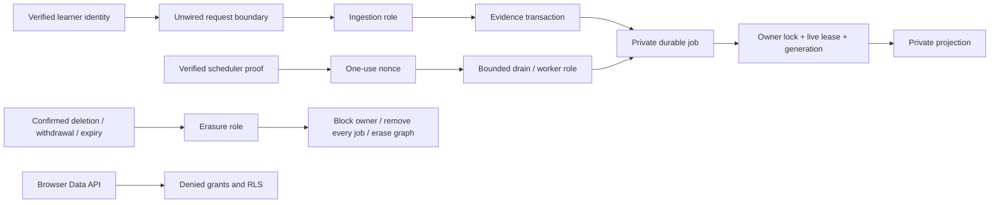
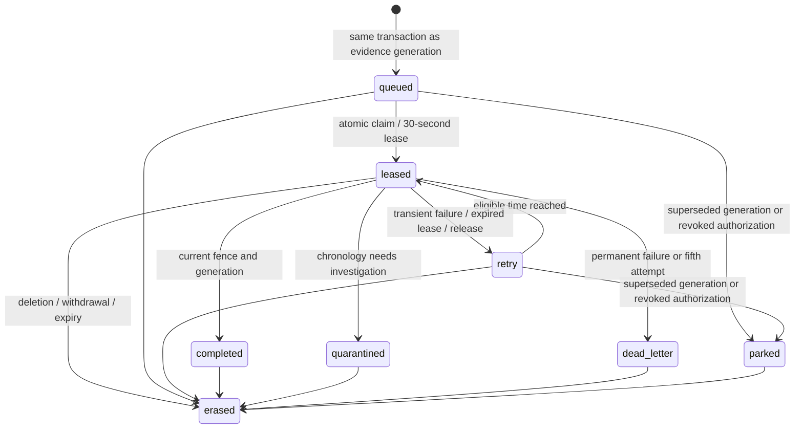

# Phase 2B-4B — durable runtime infrastructure

Date: **4 October 2026, Asia/Singapore**. Starting commit: `bd14e7f2881a99c191db579aff4179cf205d22b6`.

## Executive verdict: READY FOR PHASE 2B-4C

The production-shaped **local** infrastructure package now has separate database capabilities, a bounded transaction adapter, durable private jobs, database-enforced leases/concurrency, a separately authenticated scheduler contract, and deletion cancellation that the database independently verifies. Real local role, transaction, Auth/API, process-exit and concurrency tests pass.

**NOT READY for live migration or runtime deployment.** No production password, TLS handshake, transaction-pooler connection, scheduler identity provider, Vercel suspension lifecycle, monitoring service or recovery drill was provisioned or verified. The implementation remains unwired, default-off and hard-denied in production/Vercel. No learner-visible behavior changed.

The master plan governs product decisions. Phase 1 and the Phase 2A/2B reports were read against the actual implementation. Phase 2B-4A's deletion/privacy contracts remain requirements; its in-memory queue proof is superseded by durable PostgreSQL tests here. The prior production NOT READY verdict remains authoritative. There is no unresolved product conflict used to justify a behavior change.

## Architecture and trust boundaries

The durable store is PostgreSQL, using the existing pinned `postgres@3.4.9` driver. No additional infrastructure or dependency was installed. No routed `api/` file, cron configuration, frontend import or deployment configuration was added. The existing legacy learner flow and account deletion route remain unchanged.

## Role and grant matrix

The migration creates three **NOLOGIN, NOSUPERUSER, NOCREATEDB, NOCREATEROLE, NOINHERIT, NOBYPASSRLS** groups. It creates no password or deployable login. Purpose policies apply only to these server roles; they are not granted to Authenticator, anon or authenticated.

| Capability | `adaptive_ingest` | `adaptive_worker` | `adaptive_erasure` |
| --- | --- | --- | --- |
| Read shared adaptive catalogue and relevant history | Yes; projection reads revoked | Yes | No |
| Read protected grading keys | Yes, for trusted grading | No | No |
| Read immutable model payloads | No | Yes | No |
| Create sessions/manifests, answers, session/intervention events | Yes | No | No |
| Create recommendations/tasks/task events and publish projections | No | Yes, with current job fence | No |
| Owner state | Read; insert owner/counter; update counter only | Read; insert owner; update replay fields only, fenced | No direct writes |
| Enqueue current owned generation | Scoped function | Scoped function | No |
| Claim/finish jobs; consume scheduler nonce; read aggregate metrics | No | Scoped functions | No |
| Read raw job rows | No | Yes | No; scoped count instead |
| Read enrollment/erasure operations | No raw access | No raw access | Yes, for retention and recovery |
| Confirm/begin/resume erasure and cancel owned jobs | No | No | Scoped functions |
| Read raw Auth users or directly erase arbitrary graphs | No | No | No |
| Enroll participants, approve/publish/activate versions | No | No | No |

`assert_owner_writable` and `shadow_allowed` are now narrow definer helpers returning an enrollment fence or boolean. They do not give ingestion/worker raw consent or erasure records. Queue transitions and erasure functions are private definer capabilities with empty search paths, fixed object qualification and explicit execution grants. SQL validation verifies the required `postgres` ownership and revoked anon/authenticated execution. Database-owner authority remains an administrative trust boundary.

Existing broad `service_role` grants are retained for the earlier disposable fixture/publisher path, **not selected as runtime database credentials**. The new connection adapter refuses that role. Purpose roles are server capabilities spanning eligible owners; verified identity and owner-scoped server services remain mandatory. They are not user-impersonation roles and must never be exposed through JWT role claims.

Managed-Supabase behavior was tested: local `postgres` is **not** a superuser. On PostgreSQL 17, its creator membership in a new role has ADMIN but initially SET=false. The disposable harness explicitly enables SET with INHERIT=false for its tests. This is a test setup change, not a production runtime grant. A temporary restricted ingestion LOGIN is generated with a random in-memory password, granted exactly its purpose group, used for actual adapter ingestion, then dropped. No password is printed or committed. Future reviewed provisioning must create equivalent separate logins and audit inherited PUBLIC privileges against the actual project.

## Connection contract

`production-database.mjs` requires explicit `mode=production_shape_validation`, a purpose, and disposable-local runtime environment. Both supplied and process production/Vercel markers deny construction. Browser execution and browser-prefixed adaptive secret/URL configuration are rejected. The old loopback-only adapter remains available solely for disposable fixtures.

Accepted configuration is deliberately narrow: PostgreSQL protocol, shared Supabase pooler hostname shape, port **6543**, database **postgres**, purpose-specific login plus project reference, no query/hash overrides, and a database password distinct from API/service keys. The actual future hostname must be copied from Connect; the synthetic test hostname is not a provisioned endpoint.

Transport requires explicit CA material and `rejectUnauthorized:true`. Driver options force **max=1 per purpose**, `prepare:false`, `max_pipeline:1`, connect timeout 3 seconds, idle timeout 5 seconds and maximum connection lifetime 60 seconds. Module-scoped reuse rejects conflicting configuration for a purpose.

Every operation runs in a transaction. After a bounded reservation, it checks the actual session login's authority and sole group membership, applies `SET LOCAL ROLE`, and sets local lock timeout **1 second**, statement/idle transaction timeout **5 seconds** for ingestion/erasure or **10 seconds** for workers. Callback deadlines reject further use of the transaction wrapper after timeout. Failed transactions roll back. Acquisition is bounded at **3 seconds**, including a tested late-reservation release; raw driver errors/URLs are replaced by fixed errors and safe events. Explicit close-all supports a future platform suspension hook.

No role, advisory session lock, temporary object or prepared statement is expected to survive a transaction. The adapter uses a reserved client only to bracket BEGIN/COMMIT/ROLLBACK; transaction-local state is restored on each operation. Actual tests use an injected loopback driver with a restricted login and plaintext **local** transport. They prove options, grants, transactions and timeouts; **they do not prove TLS, Supavisor backend reassignment, production CA validity or Vercel suspension handling**. Platform lifecycle wiring remains absent.

## Durable queue and state machine

`adaptive_private.projection_jobs` contains only job UUID, owner/enrollment IDs, evidence generation, version triple, status/attempt, eligibility and lease times, monotonic fence, bounded jitter/reason, and timestamps. It has no selected answer, grading payload, email, bearer token or free-form error field.

Deduplication is the unique tuple `(owner, enrollment, generation, mapping, algorithm, configuration)`. Enqueue derives generation and version triples from owned database history; a caller cannot choose an arbitrary generation/version. Completed rows retain the deduplication identity until participant erasure. All job states remain within the participant's enrollment/erasure retention scope.

Generation changes enqueue inside the **same database transaction** through a trigger. Answer/intervention invalidation remains atomic. Session lifecycle, review task and task-event changes now also invalidate and enqueue; the former JavaScript session-event generation update is removed to avoid double counting. A rollback removes both evidence changes and jobs. There is no vulnerable post-commit enqueue call or undurable watermark.

A global sequence supplies increasing fencing tokens. Claim, recovery and finish invalidate older tokens. Attempts are capped at **five**. Retry/release delays use database time and **2, 4, 8, 16 seconds**, plus stored jitter **0–500 ms**; a fifth failure becomes dead-letter. Expired leases are recoverable by subsequent claims. Quarantine is distinct from transient retry and requires investigation. A changed generation stays queued independently while obsolete queued/retry work is parked.

## Lock and concurrency protocol

All writers retain the Phase 2B-4A canonical UUID owner advisory lock (`hashtextextended(owner,7919)`). Queue candidates are read **without row locks**. A bounded scan selects at most one candidate per eligible owner and at most 100 owners; it excludes expired enrollments and erasure blocks. It tries the owner lock, then tries a global claim mutex. Both attempts are nonblocking. Only then does it lock/update job rows and test capacity.

The mutex serializes capacity decisions across independent transactions. A partial unique index enforces one leased row per owner; a count under the mutex enforces **two unexpired global leases**. Claim skips locked owners so a blocked owner does not monopolize the first 100 job rows. A scan that finds only locked owners can return empty; another scheduler invocation retries. Fairness beyond the bounded candidate window is not a large-cohort guarantee.

Default replay time comes from the database after loading the owner-locked snapshot, matching the clock used for receipts and leases. Application/VM clock skew therefore does not falsely quarantine newly committed receipts. A regression test simulates an application clock one minute behind. Explicit synthetic clocks remain available for chronology tests.

Publication takes owner → job/state/projection locks and rechecks enrollment, erasure block, lease expiry, fencing token, version triple and evidence generation. Worker-role writes to projections, recommendations, review tasks/task events and replay state require the current transaction's job context. A stale worker cannot use a newer enrollment or publish after expiry. The worker checks the lease after computation and before transaction return, including empty-result replays. Already-running valid work may commit before deletion gets the owner lock; deletion then removes it.

The limit is a limit on **valid database leases**, not a claim that an arbitrarily paused external process stops consuming CPU at expiry. The bounded worker adapter and final fence prevent that stale process from publishing. Larger synchronous projector workloads and full model execution require Phase 2B-4C measurement.

## Scheduler authority and deadlines

`scheduler-boundary.mjs` is an unwired Fetch handler. It defaults to denial and requires an injected verifier for a separate `Scheduler` credential. A learner `Bearer` token is rejected before verification. The verifier contract must verify signature, issuer, server identity, audience and expiry; it returns only a scheduler authority for `adaptive-worker`, a nonce and expiry no more than 60 seconds away.

The nonce is SHA-256 hashed and consumed once by a private database function. Overlapping requests cannot consume it twice. Expired nonce rows are removed on consumption; at most 120 live proofs are accepted per rolling expiry window. The table has no owner or credential field. No real credential verifier/provider is configured; the test verifier uses synthetic proofs.

Only POST JSON `{}` is accepted: no caller-selected owner/job/version. Body size is **1 KiB**, with a total one-second read budget; verifier budget is one second, nonce operation three seconds, drain response budget 30 seconds. The drain accepts a 20-second work deadline and at most five jobs, rereads kill control before claim and execution, and bounds injected projection waiting at ten seconds. In-flight database work may complete within its transaction/lease budget; HTTP timeout does not claim instant global cancellation. The future central control source and platform timeout configuration need separate validation.

Responses contain only status, bounded aggregate counts and random incident IDs. Overlapping drains rely on database capacity/fencing. No assumption is made that cron retries a failed invocation. Durability resides in the queue, and a future scheduler must keep invoking it.

## Deletion and retention integration

`createDurableQueue` replaces the in-memory adapter in the **entire Phase 2B-4A audit**. Cancellation requires a durable owner erasure block, takes the owner lock and deletes every owned queue row, including leased, delayed, completed, parked, quarantined and dead-letter records. There is no separate answer/payload or lease table left behind.

`remaining_owner_jobs` counts every status. A new database trigger independently rejects erasure transitions to jobs-cancelled, graph-erased or completed while jobs remain. A fake cancellation adapter returning zero therefore cannot assert completion. Repeated cancellation is safe while the erasure operation retains its owner. The existing graph, external-cleanup, Auth-deletion and privacy-safe receipt lifecycle is preserved.

Withdrawal and expiry use the same deletion path and retain ordinary Auth accounts. Re-enrollment creates a fresh UUID and cannot revive an old job. Queue rows, including completed deduplication records, disappear on erasure. Raw data retention, incomplete erasure recovery and historical-backup limitations remain as documented in Phase 2B-4A. No production expiry/resume scheduler or backup reconciliation was deployed.

## Local evidence and measurements

Disposable unlinked stack: `/tmp/secureplus-phase2b2-resume.5kVVpr`, CLI **2.119.0**, PostgreSQL **17.11**, existing Colima/Docker. All mutable database/API commands targeted this local stack. Fixture accounts and editorial approvals are synthetic; no real version was approved or activated.

The infrastructure suite exercises actual SET ROLE permissions and a real restricted-login adapter; twelve concurrent enqueue/claim calls; two global/one-owner lease limits; skipping a locked owner; rollback of enqueue; all retry attempts and jitter; stale acknowledgments/retries/releases; superseded generations; quarantine; deletion during publication; false cancellation attestation; withdrawal/re-enrollment/expiry; and privacy-safe logs.

Separate Node child processes exit after claim and during the replay transaction, leaving durable leases for recovery and no partial cache. Tests also lose an acknowledgment after successful publication, recover with a new fence and verify one idempotent cache row. One test waits through the actual **30-second lease** during computation and proves publication/replay-state rollback. Other expiry tests deliberately move only synthetic local lease timestamps to avoid redundant waits; they are not claims of production clock/failover behavior.

The Phase 2B-4A suite retains real Auth creation/sign-in, session revocation and failed refresh, retry after actual Auth deletion, partial external failure, owner/cross/anonymous REST denial, working GraphQL control/introspection, denied browser writes, private-schema denial and other-owner/catalogue/editorial preservation. Its count increases from 226 to **244** because the new private tables and GraphQL fields are tested. No privacy or deletion assertion was removed.

Representative local measurements from the fresh run (single run, not percentiles or production capacity):

| Synthetic operation | Elapsed |
| --- | --- |
| Twelve concurrent deduplicated enqueue requests | 60 ms total |
| Concurrent claim/capacity exercise | 29 ms total |
| One acknowledgment | 5 ms |
| 10-answer ingestion / replay plus acknowledgment | 94 ms / 13 ms |
| 500-answer ingestion / replay plus acknowledgment | 3,796 ms / 22 ms |

Replay timings include database snapshot loading, chronology checks, a synthetic empty projector and acknowledgment. They **exclude the complete Phase 2A model/planner**, TLS, WAN latency, cold starts and production contention. They establish no production throughput or latency commitment.

## Operational events and proposed alerts

Fixed events in the server emitter cover runtime rejection/acceptance, enqueue/deduplication, claim, recovery, acknowledgment, retry/release, quarantine/park, cancellation, generation conflict, kill denial, scheduler authentication denial and connection denial/failure. Fields remain fixed codes, count, bounded timing and random incident ID; no raw error, SQL, URL, token, job or learner ID is accepted.

Database-side enqueue and queue transitions also append private `runtime_receipts`, with a fixed event code, count, timestamp and random incident ID only. This covers automatic trigger enqueue even if the submitting process dies. `runtime_metrics()` returns aggregates for the last 14 days and deletes at most 1,000 older receipts per call. The future operations scheduler must invoke it; this bounded cleanup is not an autonomous wall-clock retention guarantee. Scheduler nonce cleanup similarly runs on use.

Proposals only: alert for oldest eligible job over five minutes, repeated lease recovery, any dead-letter, any failed erasure, increasing incomplete-erasure age, unexpected connection denial, or shadow privacy violations. Investigate each quarantine. Alert if accepted work continues after control is disabled. **No dashboard, external sink, alert routing, named on-call operator or centralized kill infrastructure exists in this delivery.**

## Validation executed

| Check | Result |
| --- | --- |
| Fresh local reset | PASS; all three additive migrations in order |
| `adaptive-local-checks.sql` | PASS, rollback-only; session lifecycle now explicitly contributes to generation |
| `adaptive-infrastructure-local-checks.sql` | PASS, rollback-only roles, grants, definer ownership/search paths and RLS |
| `audit:learning-infrastructure` | PASS, 116 assertions; restricted roles/adapter, durable concurrency, real process exit, expiry, deletion and scheduler |
| `audit:learning-deletion-shadow` | PASS, 244 real Auth/API/SQL assertions against durable queue |
| `audit:learning-database` | PASS, 26 existing assertions |
| `audit:learning-boundary:database` / `audit:learning-boundary` | PASS, 18 / 15 |
| Runtime / persistence / pilot audits | PASS, 40 / 20 / all pilot replays and boundaries |
| Migration audit | PASS, 213 static supporting checks, including new infrastructure guards |
| DB lint | PASS, no schema errors |
| DB advisors | PASS at warning gate; informational notices explained below |
| Production build / full site audit | PASS; unchanged `main-Bfv92kCm.js`, existing >500 KiB warning; all eight site audits including editorial and strict question bank |
| Source/import and built-bundle scan | PASS, no adaptive server or credential marker in browser assets |
| Legacy API/UI/config and prior migrations | Unchanged against starting commit |
| `git diff --check` | PASS |

During development, real execution exposed a SQL named-argument typo, a PL/pgSQL alias ambiguity, a driver reservation API assumption, fixture timestamp/grant setup mistakes, and a host-versus-database replay-clock mismatch. They were fixed before the fresh pass. An old SQL fixture's expected generation increased because session lifecycle events now correctly invalidate caches. Its generation assertion was strengthened; no test was relaxed to ignore a failure. Earlier failed runs are not counted as evidence.

Advisors report only INFO: 40 unused indexes on the small reset fixture and six RLS-without-policy notices. The latter are `adaptive_private.editorial_actors`, `shadow_authorizations`, `runtime_receipts`, `scheduler_nonces`, plus local legacy fixtures `public.account_deletion_requests` and `public.profiles`. They intentionally deny client access; administrative/scoped definer capabilities perform their required work. Adding browser policies to silence these notices would weaken privacy. Unused indexes retain FK/delete/query support; their write/storage costs and usefulness need production-shaped workload measurement, not deletion based on a fresh tiny dataset.

The exact unused-index INFO inventory from this run is: `account_deletion_requests_expiry_idx`, `adaptive_concepts_reviewer`, `adaptive_question_revisions_reviewer`, `adaptive_relationships_reviewer`, `adaptive_version_events_latest`, `adaptive_version_events_actor`, `adaptive_version_sets_algorithm`, `adaptive_version_sets_configuration`, `adaptive_version_sets_algorithm_kind`, `adaptive_version_sets_configuration_kind`, `adaptive_versions_approver`, `adaptive_sessions_versions`, `adaptive_content_mappings_revision`, `adaptive_content_mappings_reviewer`, `adaptive_question_mappings_reviewer`, `adaptive_question_publications_actor`, `adaptive_evidence_revision`, `adaptive_evidence_versions`, `adaptive_interventions_time`, `adaptive_interventions_concept`, `adaptive_interventions_recommendation`, `adaptive_interventions_mapping`, `adaptive_interventions_content`, `adaptive_interventions_versions`, `adaptive_recommendations_concept`, `adaptive_recommendations_mapping`, `adaptive_recommendations_content`, `adaptive_recommendations_versions`, `adaptive_tasks_due_time`, `adaptive_tasks_due_set`, `adaptive_tasks_concept`, `adaptive_tasks_target`, `adaptive_tasks_mapping`, `adaptive_review_tasks_versions`, `adaptive_projections_mapping`, `adaptive_projections_versions`, `shadow_authorization_actor`, `runtime_receipt_retention`, `projection_jobs_runnable`, `scheduler_nonce_expiry`.

## Official documentation and material conclusions

- [Supabase PostgreSQL roles](https://supabase.com/docs/guides/database/postgres/roles): separate service logins from group capabilities; do not reuse the administrative login. This phase creates only groups in the migration and proves a temporary restricted local login.
- [Connection modes](https://supabase.com/docs/guides/database/connecting-to-postgres): use transaction pooling for the selected serverless architecture, disable prepared statements/pipelining, and copy the actual endpoint from Connect. Configuration tests are not a pooler handshake.
- [Vercel pool lifecycle](https://vercel.com/kb/guide/efficiently-manage-database-connection-pools-with-fluid-compute): bounded module-scoped pools need suspension handling. The close hook is implemented; actual platform integration is a later gate.
- [Vercel cron management](https://vercel.com/docs/cron-jobs/manage-cron-jobs): overlapping invocations and absent automatic retries require durable state and idempotency. The database owns those guarantees here.
- [Supabase changelog](https://supabase.com/changelog), [PostgreSQL minor-version changes](https://supabase.com/changelog/postgres-15-19-17-11-breaking-changes), and the prior reports' grants/GraphQL guidance: explicit role/API tests remain necessary; local 17.11 does not establish production 17.6 compatibility. No extension or production PostgreSQL upgrade was performed.

## Files changed

- New CLI-created `supabase/migrations/20261003043634_adaptive_durable_runtime.sql`: roles, queue, nonces, operational receipts, atomic enqueue, lease/fencing/capacity functions, worker guards and deletion completion check.
- New `server/adaptive/production-database.mjs`, `durable-queue.mjs`, `scheduler-boundary.mjs`.
- Updated `persistence.mjs`, `projection-worker.mjs`, `job-boundary.mjs`, `operations.mjs`: trigger-based invalidation, publication fencing, bounded drain and fixed event codes.
- New `scripts/audit-learning-infrastructure.mjs`, `scripts/lib/adaptive-crash-worker.mjs`, `supabase/validation/adaptive-infrastructure-local-checks.sql`.
- Updated deletion-shadow/database/boundary-database/migration audits and existing rollback SQL for durable cancellation and new generation semantics.
- `package.json`: one opt-in audit command, no dependency/lockfile change.
- This report.

The in-memory queue remains only as an explicitly labelled older unit fixture. It is not the main evidence or a production-shaped fallback. Unrelated `.gitignore`, Android/Capacitor, generated audits, output/review exports and Supabase temporary files remain unstaged.

## Remaining blockers and exact next gate

**Proceed to local Phase 2B-4C:** implement the complete pinned projection/intervention/planning adapter and enrollment-bound immutable session-plan store. Exercise it through the restricted roles, real durable queue and deletion suite; preserve the real RTO scenario shortage. Reconcile task writes with generation changes atomically: worker-created tasks invalidate the current generation, so no caller may publish an old-generation cache afterward. Measure full model cost and bound history/input/CPU before claiming production capacity.

Before any live migration or runtime deployment, separately require:

1. Human review of the three migrations and checksums; target-version rehearsal; actual project-wide grants/PUBLIC privileges, API exposure and definer ownership checks; recovery point and restore/erasure reconciliation.
2. Reviewed purpose login provisioning, actual pooler endpoint/CA/TLS and role-membership rehearsal, connection budgets across instances, region/network tests, credential rotation and revocation. No existing service key may become a database password.
3. A real scheduler proof verifier/provider, approved platform timeout and pool suspension integration, fresh centralized kill control, repeated scheduling, monitoring and bounded retention/retry operations. The injected verifier is a contract, not deployed authentication infrastructure.
4. Reviewed integration into the existing confirmed account deletion path, including real Stripe and Storage-owned objects, truthful partial-failure responses and privacy-safe logging. Existing routes remain untouched.
5. Complete pinned learning/plan storage behavior, sufficient human-reviewed content and scenario independence, accepted consent/retention/observation budgets, and explicit cohort approval. Agent fixtures never confer human approval.
6. Separate explicit live migration permission, later runtime deployment permission, and later shadow enablement. Learner publication/influence, UI, rewards, pricing and entitlements remain separate phases.

**No live Supabase mutation, production credential provisioning, production environment change, deployment command, real version approval/activation or cohort occurred.** Delivery is a task-only source commit with `[skip deploy]`; the repository skip script recognizes that marker. This is not a deployed-service verification.
