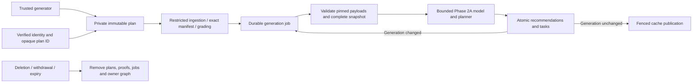

# Phase 2B-4C — trusted learning runtime

Date: **4 October 2026, Asia/Singapore**. Starting commit: `8a0f4691f4a91934b95939eaacd1e478e4c41189`.

## Verdict: READY FOR PHASE 2B-4D

The local trusted-plan and complete learning-runtime gate passes. The final clean reset, real Auth/PostgreSQL integration suites, deletion and durable-job suites, database lint/advisors, production build, all eight site audits and isolation checks passed. This verdict authorizes no live action.

**Production remains NOT READY.** This work creates no public route, scheduler deployment, production credential, real editorial approval, active cohort, live migration or learner-visible behavior. Existing requests, selection, grading displays, rewards and entitlements continue using their existing implementation.

Authority: the master plan supplies approved product decisions; Phase 1 supplies its dated implementation facts; the Phase 2A and Phase 2B reports and actual modules supply the successive local contracts. The Phase 2B-4B report and migration checksums matched the reviewed starting evidence. No unresolved product conflict was used to change learner behavior. All earlier live-release blockers remain gates, not implied permission.

## Architecture and capabilities

The new path composes the existing authenticated Fetch boundary with a private plan resolver and trusted completion verifier. `createTrustedProjectionDrain` composes the existing durable queue/scheduler with the complete projector. Both remain unwired. Defaults and production/Vercel denial stay in the earlier boundaries and database adapter.

| Capability | Ingestion | Worker | Erasure | Browser roles |
| --- | --- | --- | --- | --- |
| Store a validated server plan | Scoped function | No | No | No |
| Resolve an owned, enrolled plan | Scoped function | Read private snapshot | No | No |
| Read grading keys | Existing trusted grading capability | No | No | No |
| Read immutable model payloads | No direct table access | Yes | No | No |
| Verify completion from owned graded checks | Scoped function | Read resulting proof | No | No |
| Materialize derived recommendations/tasks | No | Current leased-job function | No | No |
| Publish concept projections | No | Existing lease and generation guards | No | No |
| Delete private plans/proofs | No | No | Scoped erasure only | No |

The three role groups remain separate NOLOGIN capabilities. No new login or password is created by the migration. Purpose roles are trusted server capabilities across eligible owners, not user-impersonation roles. Authentication and owner resolution remain mandatory before entering ingestion. Administrative fixture authority is explicitly different from runtime authority.

## Immutable session-plan contract

New `adaptive_private.session_plans` stores a random plan ID, owner, enrollment UUID, unique session UUID, creation time, exact plan document and ordered item manifest. The document binds source, mode, seed, requested counts, ordered revision IDs and mapping/algorithm/configuration versions. Each ordered item binds position, question/revision ID and canonical component identities. Grading payloads are not included.

`store_session_plan` checks the current enrollment and shadow authorization, human-approved revisions/mappings, active publication, unique revisions, counts and component availability. It derives component identities from the immutable database registry. The document is bounded at 256 KiB, the manifest at 1 MiB, 500 items and 200 components per item. Identical retries return the same plan; changed/reordered retries fail. The server generator accepts requested counts 10–30 and reports reduced coverage rather than inventing filler.

The generator runs the full pinned planner, takes its eligible selections, then considers deterministically ordered unseen approved candidates. It enforces concept, difficulty, remediation and exact-repeat caps; exam plans cap PBQs at floor(count × 0.30). The limited pilot catalogue can therefore produce fewer than the requested questions. It does not claim full-bank blueprint coverage or supply learner delivery/entitlement integration.

The browser contract remains `{planId}`. Clients cannot send revision lists, counts, source, correctness, versions or model state. The resolver checks owner, enrollment and current authorization. Deferred database triggers require restricted-ingestion sessions/items to match the stored document exactly. Grading validates the session item and immutable stable components. UPDATE/DELETE/TRUNCATE are denied outside scoped erasure.

Older service-role fixtures can still create their earlier manifests to keep the historical audits executable. This is an explicit administrative test compatibility boundary, not a restricted-ingestion bypass. The production-shaped adapter continues to reject service-role credentials.

## Pinned model and complete snapshot

`runtime-bundle.mjs` loads the exact job triple. Each registry record must have the expected kind, explicit human-approval metadata, a full immutable payload and a matching canonical SHA-256. The mapping payload binds the sealed catalogue digest. Algorithm metadata pins the implemented Phase 2A engine/planner and the server adaptation modules by source digest; unknown implementations fail. Configuration is complete, version-matched, structurally validated and permits only human-reviewed mappings. No default payload, newest version or inferred approval substitutes for missing data.

This implementation adapts `calculateConceptMastery` and `scheduleConceptReview`. Two additive options preserve prior default behavior: conservative prior exposure for incomplete/differently-versioned history, and excluding inactive revisions from future task candidates. The existing Phase 2A scenarios continue to test the same learning rules.

Under the owner lock and durable lease, replay loads:

- All retained sessions and lifecycle events, exact plans and enrollment fences.
- All retained answer evidence, occurrence/receipt order, stable PBQ selections/components, precision/provenance and supersession links.
- Recommendations, interventions, private completion proofs, review tasks and task events.
- The exact catalogue, relationship/content mappings, historical revision metadata, publication eligibility and all three version payloads.

Complete evidence under the job triple drives its model. Other versioned or incomplete history is retained for conservative novelty where question/scenario identity is known; it does not award mastery under a different model. Unresolved chronology fails closed; the default replay clock is the database clock. Missing owned plans, mappings, payloads or correction links do not become guessed evidence.

The current private completion/projection outputs are not exposed as learner feedback. The module can recompute the full plan with reasons and priorities; persisted recommendation/task ledgers retain source evidence, pinned versions, reasons and eligibility gates.

## Correction, novelty and PBQ behavior

Replay walks complete correction chains, rejects missing/cyclic/foreign observation links, and uses only effective leaves for correctness and concept influence. Replaced contradictions and successes no longer affect the model. Classification is recomputed in occurrence order across full retained history, not copied from receipt-time classification. A late answer therefore changes novelty correctly on the next replay.

Distinct-question/scenario counts describe effective direct evidence for the pinned model. Known incomplete or differently-versioned exposures conservatively prevent those identities from appearing fresh. Unsupported PBQs retain their selected component identities and complete/coarse provenance, but neither correct nor incorrect coarse outcomes establish individual concept mastery. Legacy records remain unknown/inferred; their missing fields are never fabricated.

Correcting a recommendation's source miss away, or correcting a graded completion check, removes that intervention's model influence. The immutable history and proof remain auditable until erasure. Supporting RPO recommendations do not lower or raise RPO mastery without direct evidence.

The real m032/m635 RTO pair still shares one scenario family. No authored coverage or editorial metadata was changed. The existing real-bank pilot still reports insufficient variant coverage. Richer synthetic catalogue families test the proof ladder only; they are not production content or real editorial approvals.

## Trusted intervention and task adapter

The implemented completion criterion is `server_graded_targeted_check_v1`. An immutable configuration maps a content ID to approved check revisions and a minimum correct count. Verification requires owned, complete, direct, server-graded, effective answers in targeted-review sessions with current enrollment plans, matching versions, after the recommendation and by the completion event. It records the specific evidence IDs in `adaptive_private.intervention_proofs`.

A learner's “completed” event without evidence remains unverified. Even an injected callback returning `verified:true` cannot bypass the restricted-ingestion database proof guard. Opening a lesson, self-rating a card or waiting on a page cannot prove completion. Other completion criteria remain unverified until implemented and reviewed; this phase does not invent a generic lesson-completion rule.

The full model produces direct/supporting recommendations, transfer, original recall, delayed proof, maintenance and explicit shortage outputs. Supporting recommendations require approved relationship edges; they never create direct evidence. Task completion is derived from effective graded evidence satisfying the exact target and both time/set gates. Existing terminal tasks remain historical; changed desired tasks are superseded through append-only events. No learner field directly marks a task complete.

## Generation protocol and crash convergence

`apply_learning_outputs` is a narrow private definer function. It checks a live, current job lease before writing; takes owner/version identity only from that job; bounds output sizes; validates idempotency identities and normal table constraints; and checks the lease again afterward. It does not grant the worker broad definer access or a way to choose another job's owner/version.

1. Replay computes deterministic desired outputs from immutable facts.
2. The function inserts only missing recommendations/tasks/events. Conflicting identities fail. Existing exact identities are unchanged.
3. If task/event writes advance evidence generation, the same transaction parks the old lease with `generation_changed`. Existing generation triggers enqueue the resulting generation atomically. This replay returns `rescheduled` and publishes no cache.
4. A later claim loads the resulting generation. When desired output writes are a no-op, the existing worker publishes projections under that current generation and lease, then acknowledges the job.

There is no stale-generation rebase or silent mutation of a claimed generation. The old claim cannot acknowledge/publish after rescheduling. Intermediate generated jobs can be parked by the existing queue's obsolete-generation handling. New learner facts cause a new replay instead of being lost behind an old cache.

Tests exit separate Node processes after task commit and after cache commit before acknowledgment, then recover the durable jobs. They verify no stale first-phase publication, increasing/rejected old leases, identical task counts and a current-generation cache. Fixed-history test runs terminate in fewer than five claims; the measured 10/500-answer runs use two. The scheduler retains its five-claim, 20-second work and 30-second response budgets. Continuous new evidence may require later invocations; no claim is made that an endlessly changing history reaches a final fixed state in one drain.

## Resource bounds and failure behavior

| Resource | Enforced limit |
| --- | --- |
| Retained answer rows | 10,000, including correction history |
| Sessions | 2,000 |
| Each other history collection | 10,000 |
| Each catalogue collection | 2,000 |
| Owner snapshot | 8 MiB JSON budget; DB preflight before transfer, final serialized check |
| Model/planner execution | Isolated Node worker, 2-second deadline, termination on timeout |
| Worker memory | 128 MiB old generation / 32 MiB young generation |
| Derived output batch | 1 MiB, 300 recommendations, 300 tasks, 1,000 task events |
| Database operations | Existing restricted adapter's transaction, statement and lock budgets |

The model thread receives an empty environment and no database handles. It loads only pinned local code and the prepared snapshot. Limits reject the whole replay; they never truncate history and publish an incomplete success. A timeout is retryable under existing bounded queue rules. Invalid payload/history is not published; the old cache remains stale after evidence invalidation. Larger histories require a separately validated bounded/full-history strategy before expanding these limits. Local worker-thread behavior is not a Vercel lifecycle or capacity rehearsal.

## Deletion and privacy

The existing scoped owner eraser now removes completion proofs and plans before removing the prior owner graph. It retains owner-first locking and durable job cancellation. The renamed earlier graph implementation remains private and revoked from runtime roles. Withdrawal and expiry use the same extension; re-enrollment obtains a new UUID and cannot resolve old plans.

The Phase 2B-4A suite uses the durable queue and now checks the added tables through owner/cross-owner/anonymous REST and GraphQL paths. Its catalogue preservation assertion compares the entire before/after revision inventory, replacing the old assumption that a test database always contains exactly two revisions. No deletion/privacy check is relaxed.

No tokens, passwords, raw answers, owner IDs or job IDs are added to operational receipts. New paths use existing bounded event codes and receipt-only public boundary responses. There is still no production monitoring sink or live deletion-route integration.

## Validation and measurements

Disposable unlinked stack: `/tmp/secureplus-phase2b2-resume.5kVVpr`; CLI 2.119.0; local PostgreSQL 17.11. All mutable operations target localhost. Fixture identities, actors, approvals, publications and evidence are synthetic.

Long-duration learning histories use backdated synthetic sessions. Their fixture transaction temporarily replaces only the session-allocation clock trigger, supplies the monotonic counter, performs restricted-role inserts, runs deferred constraints and restores the trigger before commit. Runtime code has no timestamp override. Real Auth, grants, constraints, grading, queue transactions and publication execute normally. Tests do not pretend that weeks passed on the wall clock. The prior infrastructure suite retains its actual 30-second lease-expiry test.

| Check | Final result |
| --- | --- |
| Fresh reset and all four additive migrations | PASS, unseeded localhost reset |
| Existing rollback SQL + infrastructure SQL | PASS, both rolled back their synthetic assertions |
| Trusted runtime audit | PASS, 103 assertions |
| Prior durable infrastructure audit | PASS, 116 assertions |
| Deletion/shadow isolation with added private tables | PASS, 256 assertions |
| Database / database boundary / pure boundary | PASS, 26 / 18 / 15 assertions or tests |
| Runtime / persistence / pilot / migration audits | PASS, 40 runtime tests; 20 persistence scenarios; all pilot checks; 213 prior static migration checks |
| DB lint and advisors | PASS, zero lint findings; zero advisor WARN/ERROR findings, 44 INFO |
| Production build and all eight site audits | PASS; existing large-bundle warning |
| Bundle/source isolation and diff check | PASS; protected route/account/deployment files and earlier migrations unchanged; skip-deploy marker recognized |

The trusted-runtime suite covers real Auth and immutable-plan use; foreign enrollment, mutation, reordered/duplicate/missing plans; exact payload hashes/kinds/approval and missing payloads; full deterministic and late-order replay; correction chains; ordinary and sticky proof/mastery/relapse; coarse PBQs and incomplete novelty; task completion/idempotency; verified/unverified intervention completion and corrected proof; history/byte/CPU limits; composed scheduler execution; process exit/lost ack/stale fences; role/API privacy; withdrawal/expiry/re-enrollment and proof erasure.

Final single-run measurements from the clean matrix:

| Answers | Ingestion | Full model replay and acknowledgment | Durable claims |
| --- | --- | --- | --- |
| 10 | 78 ms | 146 ms | 2 |
| 500 | 3,664 ms | 198 ms | 2 |

Replay timings include the actual Phase 2A model/planner, database snapshot, derived writes, generation follow-up, cache publication and acknowledgment. They are single local observations, not percentiles, production capacity, latency guarantees or evidence of educational effectiveness. The earlier infrastructure audit's minimal injected projector timings are not substituted for these measurements.

The 44 advisor INFO findings comprise 38 indexes not exercised by this small disposable workload and six RLS-enabled tables without policies: private `editorial_actors`, `runtime_receipts`, `scheduler_nonces`, `shadow_authorizations`, and fixture/application `account_deletion_requests` and `profiles`. Those tables remain denied to browser roles; their scoped server functions or existing service capability supply intended access. These INFO findings do not establish production index usefulness or replace target privilege review. Lint runs after the complete fixture setup supplies the existing account-deletion table dependency; an intermediate lint before that setup correctly reported the missing application table. The final lint has no findings.

The 213 static checks cover the prior migrations; executable reset, restricted-role integration and the new 103-assertion suite validate this migration. Build emits the existing large-chunk warning. No dependency or frontend route was added.

Development failures found and fixed: fixture timestamp precision; the authoritative session-allocation clock rejecting historical fixture dates; PostgreSQL's pending deferred-trigger restriction during fixture setup; the old fixed catalogue-count assertion after adding synthetic catalogues; and a database-linter warning resolved with an explicit JSONB initializer cast. These are recorded separately from passing final evidence.

## Documentation review and live blockers

Current [Supabase RLS guidance](https://supabase.com/docs/guides/database/postgres/row-level-security) distinguishes table grants from row policies; both remain restricted. [Database function guidance](https://supabase.com/docs/guides/database/functions) informs the private, qualified definer capabilities. The [Data API grant change](https://supabase.com/changelog/45329-breaking-change-tables-not-exposed-to-data-and-graphql-api-automatically) and [GraphQL introspection change](https://supabase.com/changelog/46320-breaking-change-in-pg-graphql-1-6-0-graphql-introspection-disabled-by-default) reinforce testing actual role access and a working GraphQL control, rather than assuming unavailable introspection proves privacy.

The [PostgreSQL 15.19/17.11 change notice](https://supabase.com/changelog/postgres-15-19-17-11-breaking-changes) was reviewed. This migration adds no ltree, btree_gist, legacy-cipher encryption or custom estimator. The local 17.11 run still does not establish the actual production version's compatibility.

Remaining live blockers:

1. Human migration review, target-version rehearsal, actual grants/PUBLIC privilege/API exposure review and backup/PITR restore plus erasure reconciliation.
2. Real restricted login provisioning, TLS/CA and transaction-pooler handshake, connection budgets, credential rotation and platform suspension handling.
3. A real scheduler verifier/provider, central kill control, repeated invocation, monitoring/alerts and operators, bounded retention/retry operations, and deployment lifecycle rehearsal.
4. Explicit integration with confirmed account deletion, including real Stripe/Storage cleanup and failure recovery.
5. Human-reviewed content/scenario coverage, approved completion criteria and model/configuration versions, calibration and cohort/retention/observation budgets.
6. Separate permissions for live migration, runtime deployment and shadow enablement. UI, entitlements, rewards, pricing and Phase 3 work remain outside this phase.

The next local gate is Phase 2B-4D under its approved brief. Readiness for that gate must not be read as readiness for migration or deployment.
