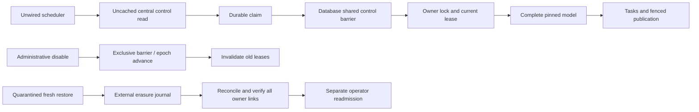

# Phase 2B-4D — operational readiness

Initial validation: **4 October 2026, Asia/Singapore**. Cleanup remediation: **5 October 2026**. Sampler remediation: **6 October 2026**. Starting commit: `cf196f8786d0392e051ae9c30084d606f46947e6`.

## Verdict: local remediation PASS; Phase 2B-5 ON HOLD

The cleanup finding is remediated and locally verified. **Phase 2B-5 remains on hold pending independent review; no Phase 2B-5 work has started.** The **local** operational checks pass: target-engine migration/recovery, restricted-role and API checks, backup-erasure reconciliation, central kill drills, bounded concurrency, monitoring contracts and all earlier regression suites pass. **Production remains NOT READY.** No live migration, deployment, production credential creation/change, runtime activation, version approval, cohort, learner behavior, pricing/legal or Phase 3 change occurred.

The Phase 2B-4C report and migration SHA-256 values matched the supplied baseline exactly. The master plan remains the product authority; the Phase 1 audit supplies its dated current-state evidence. No unresolved product conflict was used to change behavior. This package extends local operations without wiring a browser, API route or cron.

## Cleanup remediation and final control

Independent review found that baseline `3b6c337cbb7cbfa527e305a52a0c6124efc9d2d3` wrote PASS before its `finally` block merely closed connections. Since the rehearsal enabled control for 3,600 seconds, either success or an exception after enablement could leave the disposable runtime enabled until expiry. Both disposable controls were independently disabled before remediation; this was a reproducibility defect, not evidence of live activation.

The runner now captures the primary outcome, settles workload pool closure, commits administrative disable through a fresh connection, and verifies through a second fresh connection. Verification requires the stored `enabled` flag to be false, the effective control response to be disabled and its kill switch true. An expired enablement, missing row, denied query or unreachable database cannot masquerade as a confirmed disable. Cleanup transactions use a five-second lock budget and eight-second statement budget; connections have a three-second connect budget and bounded close. Cleanup failures have separate stage/code fields and cannot replace the primary error or produce PASS. No raw exception, SQL, URL, token or learner identifier is included in these receipts.

Every ordinary completion and caught failure flows through this cleanup before a final receipt is written. A new run first marks its receipt RUNNING and control UNVERIFIED, preventing reuse of a previous PASS after an interrupted run. OS termination or host loss can prevent JavaScript cleanup from running; a RUNNING/UNVERIFIED receipt is not containment evidence. In that case, or if cleanup fails, independently disable and verify the disposable database under the runbook. The bounded TTL remains a fallback, not a substitute for confirmed cleanup.

Actual PostgreSQL 17.6 checks, using the fixed disposable target:

| Scenario | Rehearsal outcome | Cleanup outcome | Independent stored / effective enabled |
| --- | --- | --- | --- |
| Complete operational rehearsal | PASS, exit 0, 80 assertions | Disable committed and verified | false / false |
| Deliberate exception immediately after first enable | FAIL, exit 1, `FORCED_AFTER_ENABLE` preserved | Disable committed and verified | false / false |
| Actual sampling backend terminated after enablement | FAIL, exit 1, `CONNECTION_CLOSED` preserved | Disable committed and verified | false / false |
| Primary exception plus denied verification connection | FAIL, primary error preserved | FAIL, separate SQLSTATE `42501`; disable committed but verification refused | false / false |

The last case deliberately uses the restricted worker role for the verification read. It proves that a cleanup failure is reported even when an independent administrator can later confirm the database is disabled. The fault-test harness then performs its own successful disable/verification. These four scenarios pass **33 regression assertions**. Fourteen operation unit tests additionally cover commit ordering, stale stored enablement, unknown/malformed state, connection and pool-close errors, dual-error privacy, pending-sample races, first-error retention and non-overlapping sampling. The isolated full-stack regression wrapper also disables and independently verifies its PostgreSQL 17.11 control in `finally`.

See [exit-path proof](evidence/phase-2b4d/cleanup-regression.json), [successful final-control receipt](evidence/phase-2b4d/final-control.json), [forced-failure receipt](evidence/phase-2b4d/forced-failure-result.json), [sampler-failure receipt and lifecycle](evidence/phase-2b4d/sampler-failure-result.json), [validation and final observations](evidence/phase-2b4d/validation.json), and [package checksums](evidence/phase-2b4d/cleanup-checksums.json). The five migration files and runtime/product code are unchanged by this remediation. No production read or write was needed for the cleanup fix; live facts below retain their original 4 October observation date.

## Sampler lifecycle remediation — 6 October

A second independent review of `53640b9f4bcff5ce3a42c5f2412af65ef1af997b` found an ordinary failure path outside the cleanup wrapper: the async `setInterval` callback could reject independently of the awaited workload. A connection failure in that callback could terminate Node before workload closure, disable/verification or a final receipt. The previous completion/error proof did not cover that timer path.

The runner now uses an awaited sampling scope. Timer callbacks attach their rejection handler immediately, record the first sample failure, stop scheduling and prevent overlap. The scope stops its timer and awaits any in-flight sample on both workload success and failure, then propagates the first observed error through the existing `runWithControlCleanup` path. Owner drains are also settled together before connections close. This does not rely on a global unhandled-rejection handler.

The new database regression terminates the actual sampling backend during the ordinary load query, with a three-second sleep added solely to make the fault window deterministic. It first verifies stored control is enabled and the query is in flight, then terminates that backend through a separate disposable administrator connection. With strict Node unhandled-rejection handling enabled, the driver returns `CONNECTION_CLOSED`; that code matches both the stored sampler error and the final primary-failure receipt. The run exits 1 with final FAIL evidence and successful cleanup, and an independent administrator confirms stored/effective enabled=false. No PASS receipt is emitted for the failed run.

The sanitized lifecycle records this order: sampling started, sampler query in flight, sampler query failed, sampling settled, workload close started, workload closed, then fresh disable/verification connections. The regression checks the order and that only one sampler failure occurred. Unit tests also inject `ECONNRESET` while a sample is pending after workload completion, prove later workload failure cannot replace an earlier sampler error, preserve earlier workload failure while settling its last sample, and prove successful sampling never overlaps or continues after stop.

During development, the first integration assertion incorrectly expected PostgreSQL SQLSTATE `57P01`; the actual driver exposed `CONNECTION_CLOSED`. That test run failed its expectation while the runner still completed verified cleanup. The corrected test asserts the observed driver code and equality across the original sampler error and both final receipts. The final evidence contains the subsequent complete passing run, not a reclassification of that failed test.

The first full-stack infrastructure rerun failed the existing fixed-host-sleep lease-expiry expectation. A temporary diagnostic copy then passed and observed only about 177 ms of database-confirmed expiry at the end of the 30.1-second host wait; the original transient cause was not established. The fixture now waits for actual database-clock expiry within a 45-second test deadline, requires SQLSTATE `55000`, and verifies that expiry was observed inside the projector before accepting rollback. It neither rewrites nor artificially ages the 30-second lease. This is a stronger validation condition, not a runtime change. The failed run and diagnostic transcript hashes are retained separately from the final complete regression run.

## Environment and parity

Read-only project metadata and SQL confirmed live release **17.6.1.113**, PostgreSQL **17.6**, `aarch64-unknown-linux-gnu`, GCC **15.2.0**, 64-bit. The official Docker Hub `supabase/postgres:17.6.1.113` image is pinned at:

`sha256:4c39816ce8d9303a3aba1161c842929c73a40c7109a9ef1b644582478e31832e`

The disposable image reports the same engine build and all five installed extension versions: `plpgsql 1.0`, `uuid-ossp 1.1`, `pgcrypto 1.3`, `pg_stat_statements 1.11`, `supabase_vault 0.3.1`. The migration principal `postgres` is **not a superuser**, matching the target. It can reference `auth.users` but cannot create Auth tables. Synthetic Auth scaffolding and full restore use separate local `supabase_admin` authority; runtime roles do not receive it.

CLI **2.119.0**, Node **24.15.0**, arm64 Docker VM with **4 CPUs / 8,307,175,424 bytes memory**. The target container is `secureplus-4d-pg176`, loopback port 55442, isolated database `adaptive_4d_rehearsal`. API rehearsal uses local PostgREST **v16.4** on loopback 55443. The established full Auth/REST/GraphQL regression stack remains separate on PostgreSQL **17.11**, `/tmp/secureplus-phase2b2-resume.5kVVpr`.

**Engine/build/installed-extension parity is established. Managed-platform parity is not.** The fixture reproduces relevant predecessor tables and synthetic MCQ, PBQ and profile data, not the entire live application/Auth schema. Actual managed Auth/PostgREST service releases, pooler/TLS, external API configuration, network policies, lifecycle and PITR are not established by this image. The live catalog has an additional `ensure_rls` event trigger; the adaptive chain explicitly enables RLS and the difference is recorded. Null catalog `pgrst` settings do not prove external gateway configuration. These remain distinct live gates, not silently passed compatibility claims.

The target lint diagnostic temporarily adds `plpgsql_check` with local recovery authority; ordinary `postgres` correctly cannot install that extension. It is diagnostic tooling, not a runtime migration or part of the five-extension parity claim. Local TCP is explicitly plaintext; TLS verification remains mandatory for a future managed-pooler adapter.

## Architecture and trust boundary

`runtime_control` is private, RLS-enabled and seeded **disabled**. Runtime roles cannot read its raw table or enable it. A narrow reader returns only control state/epoch/times. Positive responses are not cached; unavailable, malformed, expired or clock-stale responses fail closed. The existing production/Vercel hard deny remains intact.

SQL acceptance and lease validation acquire a shared advisory transaction barrier **before owner locks**. Administrative disable takes the exclusive barrier, advances the epoch and invalidates active leases. It touches jobs only after earlier guarded transactions finish. A previous transaction may commit before disable obtains the barrier; after the disable transaction commits, no old process can claim, publish or acknowledge under its old fence. A timed-out disable is **unconfirmed**, not successful containment. Expired control is checked at statement/lease boundaries; the transaction already admitted before expiry is not magically cancelled.

The setter is granted to no runtime role. Enable TTL is bounded to 1–3,600 seconds; default 60 seconds. Renewing it advances the epoch and fences leases. Deletion, withdrawal and recovery remain available while learning work is disabled. The model, owner lock, generation protocol, immutable session plans and previous resource limits are preserved.

## Migration rehearsal and inventory

The full chain ran twice from fresh representative pre-adaptive data. Existing MCQ miss/success, coarse PBQ history and profile/subscription sentinel values survived unchanged. Each migration and its checksum-journal entry committed atomically. Re-running the deployment runner skipped matching committed entries; changed checksums failed. Raw DDL is not claimed to be idempotent.

| Migration | SHA-256 | First / second run ms |
| --- | --- | --- |
| `20261001170334_adaptive_learning_persistence_foundation.sql` | `35a3161ee7023b808ad0b88eb9b2534025adf4365e45883191c72fc2884a7790` | 62 / 79 |
| `20261002232053_adaptive_deletion_shadow_isolation.sql` | `d02f367614388d0145a1b68772c9f0873b05f2919ff5710a5fa45ef68f28be9b` | 13 / 18 |
| `20261003043634_adaptive_durable_runtime.sql` | `2e81d681c1b648850372f5a34c6f64d0481338d1b303ca844f47584de1c4634a` | 14 / 16 |
| `20261003200440_adaptive_trusted_learning_runtime.sql` | `528821f54cd881b23e6ef2fffe1f3cb704a206def618407714abdc9fae562866` | 9 / 10 |
| `20261004072830_adaptive_operational_controls.sql` | `e46f7fef2e8b07924a05646f6499055986afbef453581aeca0adb8bd7ffaad28` | 4 / 3 |

The default migration budgets are 1 second of lock waiting and 10 seconds per statement. Failure drills deliberately reduce them: statement-timeout failure took **226 ms** including preceding DDL; lock-timeout failure took **108 ms**. The tests require SQLSTATE `57014` and `55P03`, respectively. Killing an actual migration backend during its open transaction also left no adaptive schema or committed migration entry. Retrying the unchanged chain succeeded.

The evidence inventory records all adaptive columns, constraints, indexes, triggers, function-body digests, definer ownership/search paths, table/function ACLs, PUBLIC execution, RLS policies, role attributes/memberships and extension versions. Fresh resets produced identical inventories. New and prior migrations remain additive; prior migration files were not edited.

Rollback decision: abort and verify atomic rollback before commit; after commit keep runtime disabled and use a reviewed roll-forward migration. Do not rewrite committed migrations or run destructive down migrations. Disaster restore is quarantined and reconciled, not a normal feature rollback.

## Recovery and kill evidence

| Boundary | Actual proof | Recovery |
| --- | --- | --- |
| claim | SIGKILL after durable claim | 153 ms; 2 subsequent claims |
| compute | SIGKILL after full pinned computation inside its transaction | 142 ms; 2 subsequent claims |
| publication | SIGKILL after current-generation publication, before acknowledgment | 84 ms; 1 subsequent claims |
| ack | SIGKILL after acknowledgment | 7 ms; 0 subsequent claims |
| scheduler | SIGKILL during authenticated local scheduler drain after claim | 162 ms; 2 subsequent claims |
| database_restart | Actual Docker database stop/start with a live durable lease | 1699 ms |

Crash cases retained exactly two unique review tasks and a current-generation projection. Old leases could not acknowledge. The new crash matrix expires selected synthetic leases administratively to avoid five serial 30-second waits; the earlier infrastructure suite still performs the actual 30-second wall-clock expiry test. These recovery timings exclude that artificial lease-aging step and are not RTO guarantees.

The ordinary transaction-barrier drill acknowledged disable after **257 ms**, waiting for the admitted transaction. A separate real full-model child paused during computation; disable remained pending until process death rolled back the transaction, then old publication/acknowledgment was fenced. Re-enable converged without duplicate tasks. Tests also cover default-off, stale control, new ingestion rejection, global two-lease cap, owner serialization, overlapping scheduler calls, invalid learner scheduler authority, queued/retry work, durable dead-letter/quarantine and observable aggregate states.

## Backup and erasure reconciliation

A real custom-format `pg_dump` captured an **older, enabled** database with synthetic owner graphs. The erasure intent, HMAC key and trusted newest checkpoint lived outside that backup, with restricted file permissions. The append-only journal checks sequence/chain/HMAC, bounds bytes/rows, rejects symlinks and concurrent writers, and fails closed on missing authority, tampering or an older checkpoint. It is sensitive recovery data, never telemetry. Production single-writer custody, checkpoint durability/replication and legal retention remain unresolved operational dependencies.

Before restore, runtime logins were set NOLOGIN and their sessions terminated. Restore into a **fresh** database used local recovery authority. The test confirmed the backup actually resurrected the erased graph and stale enabled control, while runtime login was still denied. The operator forced central disable, authenticated the external checkpoint and replayed erasure. Every owner-linked table was checked dynamically, including plans, proofs, evidence, sessions/events, recommendations, tasks/events, projections, jobs, owner state and enrollment. Incomplete erasure resumed from its committed stage; re-enrollment received a different UUID. Completed receipts retain no owner link; runtime receipts are aggregate-only.

A material defect was found in the initial rehearsal: restoring into the existing database let pre-existing default ACLs grant client table access. The passing procedure uses a fresh target, verifies restored adaptive ACLs and PUBLIC function denial, and then proves denial through working HTTP requests. This was fixed in the recovery procedure, not hidden by accepting empty RLS results.

Actual managed backup/PITR, off-host copies, retention/disposal policy, journal/key custody, Auth-session reconciliation, Stripe and Storage cleanup still require their separately approved integration. No legal approval or policy was fabricated.

## Load method and measured limits

Each workload first ingests complete immutable synthetic history, then measures the full model, snapshot, derived writes, generation follow-up, publication and acknowledgment. One shared connection per purpose is enforced through separate real restricted logins; simultaneous owners contend for those pools and the global two-lease cap. Database sampling checks connection and lease counts every 20 ms. Purpose pools are cold at first use; the remaining runs are warm. This is a direct local TCP rehearsal, not a pooler capacity test.

| Answers per owner | Concurrent owners / samples | Batch replay ms | Owner latency min–max ms | Completed owners/s | Peak purpose connections / leases |
| --- | --- | --- | --- | --- | --- |
| 10 | 1 / 1 | 208 | 207–207 | 4.81 | 2 / 1 |
| 10 | 2 / 2 | 398 | 394–398 | 5.03 | 2 / 2 |
| 10 | 4 / 4 | 815 | 429–815 | 4.91 | 2 / 2 |
| 500 | 1 / 1 | 366 | 366–366 | 2.73 | 2 / 1 |
| 500 | 2 / 2 | 606 | 602–605 | 3.3 | 2 / 2 |
| 500 | 4 / 4 | 1240 | 665–1239 | 3.23 | 2 / 2 |

Cold full replay: **178 ms**, two claims. All 14 measured owners converged in two claims; no load failure or duplicate output occurred. Ingestion timings are retained separately in the machine-readable evidence; they are excluded from replay throughput. No percentiles are claimed for 1/2/4 samples. The observed range is not a tail-latency bound.

**Tested ceiling:** four concurrent owners, 500 retained answers each, one connection per purpose, two active leases. **Conservative next local operating budget:** two concurrent owners at this history size (50% of tested owner concurrency), retaining the two-lease cap. This is a local safety margin, not an extrapolated production capacity or maximum sustainable throughput. Larger history limits remain fail-closed at 10,000 answers / 2,000 sessions / 8 MiB snapshot, with a 2-second isolated model deadline and 128/32 MiB worker heap-generation limits. Production instance count, memory, pooler and scheduler overlap need their own budgets.

## Monitoring and alerts

The SQL snapshot exposes fixed aggregate gauges only. The JavaScript monitor accepts fixed events, discards incident/owner/job IDs and arbitrary fields, bounds numeric values, uses a five-minute/10,000-event window and signals saturation. It emits p95 only with at least 20 successful observations. Existing drain events now record actual publication-phase elapsed time; full replay timings above include both generation phases. Alert output has only fixed code, severity and threshold.

| Alert code | Trigger | Severity |
| --- | --- | --- |
| `queue_backlog` | `queueDepth` ≥ 100 | warning |
| `queue_age` | `oldestEligibleMs` ≥ 60000 | critical |
| `global_lease_limit` | `leases` ≥ 3 | critical |
| `expired_lease` | `expiredLeases` ≥ 1 | warning |
| `retry_backlog` | `retryDepth` ≥ 20 | warning |
| `dead_letter` | `deadLetters` ≥ 1 | critical |
| `quarantine` | `quarantined` ≥ 1 | warning |
| `erasure_age` | `oldestErasureMs` ≥ 60000 | critical |
| `expiry_backlog` | `expiryBacklog` ≥ 20 | warning |
| `retention_backlog` | `retentionBacklog` ≥ 1000 | warning |
| `lease_recovery` | `leaseRecoveries` ≥ 5 | warning |
| `generation_churn` | `generationConflicts` ≥ 100 | warning |
| `scheduler_denial` | `schedulerDenials` ≥ 10 | warning |
| `connection_failure` | `connectionFailures` ≥ 1 | critical |
| `projection_failure` | `projectionFailures` ≥ 1 | critical |
| `projection_slow` | `projectionP95Ms` ≥ 1000 | warning |
| `kill_violation` | `acceptedAfterKill` ≥ 1 | critical |
| `connection_budget` | `purposeConnections` ≥ 4 | critical |

The sampled fault-injection run raises expected dead-letter, quarantine, lease-recovery and revoked-credential connection-failure alerts; these are not load failure rates. Scheduler denial and connection failures are exercised against actual local boundaries. Kill violations remain zero; direct database tests prove no new ingestion/claim/publication after acknowledged disable. Deterministic unit tests check every threshold below/at its boundary and reject unknown/nonfinite/negative metric input. Real alert routing, paging, delivery guarantees, aggregation across instances and operational ownership remain absent.

## Validation and evidence package

The 6 October sampler remediation reran the full target-version operational rehearsal, target HTTP isolation, cleanup regression, operations/boundary/runtime unit suites, and full-stack infrastructure/trusted-runtime/deletion/database-boundary checks. Other rows retain their passing 4 October evidence; unchanged schema/runtime/UI work did not require repeating every earlier audit. Migration, recovery and load timings above are the 6 October rerun, not the original measurements.

| Check | Result |
| --- | --- |
| Exact-version operational database/process rehearsal | PASS, 80 assertions |
| Target PostgreSQL 17.6 + PostgREST HTTP isolation | PASS, 75 assertions; working control, real signed synthetic owners and anonymous requests |
| Control/monitor/journal/cleanup/sampler tests | PASS, 14 tests including dual failures, pending samples and timer races |
| Actual cleanup exit paths | PASS, 33 assertions; normal, forced failure, sampler connection failure and separately denied verification |
| Earlier durable infrastructure | PASS, 116 assertions |
| Earlier trusted plans and complete model | PASS, 103 assertions |
| Earlier deletion/shadow isolation | PASS, 262 assertions, including the new private control table |
| Database / database boundary / pure boundary | PASS, 26 / 18 / 15 |
| Runtime / persistence / migration / pilot | PASS, 40 tests / 20 scenarios / 213 prior static checks / all pilot checks |
| Fresh five-migration reset and rollback SQL suites | PASS |
| Database lint on 17.6 and 17.11 | PASS, zero findings |
| Advisors on 17.6 | Zero WARN/ERROR; 64 INFO: 54 unused indexes, 8 policyless RLS tables, 2 unindexed fixture foreign keys |
| Advisors on 17.11 CLI fixture | Zero WARN/ERROR; 45 INFO: 38 unused indexes, 7 policyless RLS tables |
| Production build and all eight site audits | PASS; existing large-bundle warning |
| Source/bundle isolation and diff checks | PASS; existing UI/routes/account/deployment files and all earlier migrations unchanged |

INFO findings describe small synthetic workloads and intentionally inaccessible private/fixture tables. They do not prove production index usefulness. The two unindexed foreign keys belong to synthetic predecessor `attempts` and `account_deletion_requests`, not the adaptive migration. Prior static checks remain 213; new migration behavior is established by actual reset, SQL, role/process/recovery and API tests, not by claiming new static coverage.

Evidence files:

- [Validation counts, diagnostic summaries and transcript hashes](evidence/phase-2b4d/validation.json)
- [Target parity and limitations](evidence/phase-2b4d/target-parity.json)
- [Full migration/security/schema inventory and timings](evidence/phase-2b4d/migration.json)
- [Recovery matrix and kill timing](evidence/phase-2b4d/recovery.json)
- [Load runs and aggregate alerts](evidence/phase-2b4d/load.json)
- [Operational assertions and migration checksums](evidence/phase-2b4d/result.json)
- [Target API results](evidence/phase-2b4d/target-api.json)
- [Operations runbook](phase-2b4d-operations-runbook.md)

Reproduction: pull the pinned official image; run `node scripts/start-learning-rehearsal.mjs`, then `npm run audit:learning-operations:cleanup` (forced exit, sampler connection failure, full success, and verification failure), `node scripts/audit-learning-target-api.mjs` and `npm run audit:learning-operations`. The destructive reset runner checks the exact disposable container/image and uses only its fixed loopback database. It must not be adapted to accept arbitrary remote URLs. Test passwords/journal files/backups stay outside Git. Final read-only inspection still found PostgreSQL 17.6 with no adaptive schema, adaptive public relation or adaptive role in production. For the established full-stack regression matrix, install all five migrations in an unlinked CLI workdir, reset locally, explicitly enable only its synthetic control for the test duration, run both rollback SQL suites and every earlier learning audit, then lint/advisors/build/site scans. Return local control to disabled afterward.

## Remaining production gates

1. Human migration/security review and explicit live authorization; target schema/event-trigger/default-ACL reconciliation and a reviewed production deployment mechanism.
2. Actual purpose credentials and pooler/TLS handshake, rotation/revocation, process lifecycle and total connection/instance budgets.
3. Real scheduler signature/provider and central-control operator integration, alert routing, escalation ownership and on-call acknowledgment.
4. Managed backup/PITR restore with independent erasure ledger/checkpoint custody, off-host retention and external Auth/Stripe/Storage reconciliation.
5. Real editorial/scenario coverage, approved model/configuration and completion criteria, cohort/retention/observation budgets and signed acceptance criteria.

**Phase 2B-5 remains on hold pending independent review of this remediation.** This verdict is not permission to migrate, deploy, activate shadow writes or change learners' experience.

Changelog rechecked on 6 October; relevant documentation checked on 5 October: [current changelog](https://supabase.com/changelog.md), [transaction-local settings and connection state](https://supabase.com/docs/guides/troubleshooting/resolving-cannot-execute-update-in-a-read-only-transaction-on-transaction-pooler-connections-ef582c). No schema or dependency upgrade is part of this cleanup. Prior documentation reviewed: [Supabase backup/restore](https://supabase.com/docs/guides/platform/migrating-within-supabase/backup-restore), [RLS and grants](https://supabase.com/docs/guides/database/postgres/row-level-security), [database functions](https://supabase.com/docs/guides/database/functions), [Data API grant change](https://supabase.com/changelog/45329-breaking-change-tables-not-exposed-to-data-and-graphql-api-automatically), [PostgreSQL minor-version change](https://supabase.com/changelog/postgres-15-19-17-11-breaking-changes). Matching an older target engine is compatibility evidence, not approval to leave that production version unchanged indefinitely.
